# NanoKVM-USB AI エージェント統合仕様書

> **作成日**: 2026-03-08  
> **統合元**: `picoclaw-lock-login-spec.md` + `multi-agent-spec.md`  
> **ステータス**: 実装完了・運用中

---

## 目次

1. [概要](#概要)
2. [物理接続トポロジー](#物理接続トポロジー)
3. [システムアーキテクチャ](#システムアーキテクチャ)
4. [エージェント比較](#エージェント比較)
5. [AgentAdapter / AgentRouter](#agentadapter--agentrouterv)
6. [コマンド仕様](#コマンド仕様)
7. [Credential Vault](#credential-vault)
8. [入力チャネル](#入力チャネル)
9. [Vision LLM（画面検証）](#vision-llm画面検証)
10. [設定管理](#設定管理)
11. [API Server](#api-server)
12. [制約事項・レートリミット](#制約事項レートリミット)
13. [変更履歴](#変更履歴)

---

## 1. 概要

NanoKVM-USB デスクトップアプリの AI エージェント機能。Electron アプリで **picoclaw**（Go 製）と **zeroclaw**（Rust 製）の 2 つのエージェントを排他切り替えで利用できる。

**設計方針**:
- 排他切り替え式（同時に 1 つのエージェントのみアクティブ）
- LLM プロバイダー/モデル/API キー設定は UI で共通管理
- 各エージェントの固有設定ファイルに自動同期
- Chat UI・プロンプトは共通利用
- ローカル API サーバー（port 18792）を両エージェントで共有
- **メッセージ処理の統一**: Chat UI と Telegram の 2 つの入力ルートがあるが、処理パスは `AgentRouter.sendMessage()` に一本化。Telegram は `TelegramService` が担当

---

## 2. 物理接続トポロジー

<div class="figure-block">

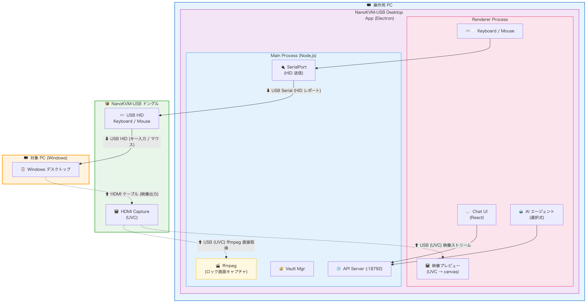

</div>

> **実線 (→)**: HID 制御パス（操作 PC → NanoKVM-USB → 対象 PC）  
> **破線 (-.->)**: 映像パス（対象 PC → HDMI → NanoKVM-USB → USB(UVC) → 操作 PC）  
> **USB ケーブルは 1 本**: HID Serial と UVC 映像が同一の USB 接続上で多重化

### データパス

| パス | 方向 | 接続 | プロトコル | 説明 |
|------|------|------|-----------|------|
| HID キーボード/マウス | 操作PC → NanoKVM → 対象PC | USB (Serial) + USB (HID) | USB HID over Serial | キー入力・マウス操作を送信 |
| HDMI 映像 | 対象PC → NanoKVM → 操作PC | HDMI + USB (UVC) | HDMI → UVC 変換 | 対象 PC の HDMI 出力を NanoKVM が UVC カメラに変換し USB 経由で操作 PC に配信 |
| 映像キャプチャ (通常) | NanoKVM → Renderer | USB (UVC) | WebRTC getUserMedia | Renderer の canvas で映像プレビュー＆スクリーンショット取得 |
| 映像キャプチャ (ロック時) | NanoKVM → Main (ffmpeg) | USB (UVC) | ffmpeg 直接取得 | 対象 PC がロック画面等で Renderer の映像が停止した場合のフォールバック |
| AI エージェント | 操作PC 内 | — | HTTP (localhost:18792) | LLM → API → HID 変換 |

### NanoKVM-USB デバイス仕様

- **USB HID**: キーボード + マウスの複合デバイスとして対象 PC に認識される
- **HDMI キャプチャ**: UVC 準拠カメラデバイスとして操作 PC で映像取得
- **シリアルポート**: 操作 PC の NanoKVM-USB Desktop App と通信（HID レポート送信）
- **HID レポート**: 8 バイト構造: `[modifiers, reserved, key1, key2, key3, key4, key5, key6]`
- **制約**: 同時押し最大 4 キー（修飾キー除く）

---

## 3. システムアーキテクチャ

### 全体構成ブロック図

<div class="figure-block">

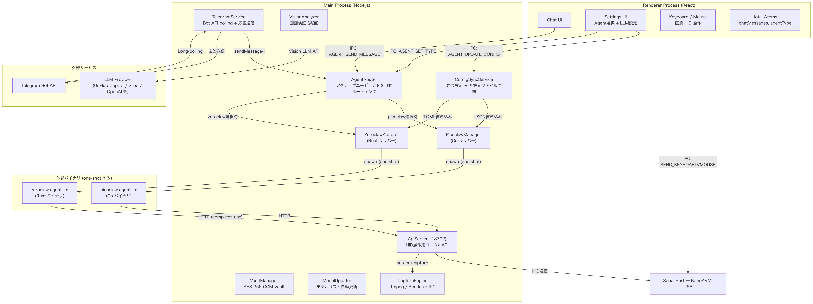

</div>

### バンドル済みコンポーネント

| コンポーネント | サイズ | 配置場所 |
|---------------|--------|---------|
| picoclaw (Go) | ~8 MB | `resources/bin/picoclaw` |
| zeroclaw (Rust) | ~8.8 MB | `resources/bin/zeroclaw` |
| ffmpeg | ~70 MB | `node_modules/ffmpeg-static/` → extraResources |

---

## 4. エージェント比較

| 項目 | picoclaw | zeroclaw |
|---|---|---|
| **言語** | Go | Rust |
| **メモリ** | < 10MB | < 5MB |
| **起動時間** | < 1s | < 10ms |
| **バイナリ配置** | `resources/bin/picoclaw` | `resources/bin/zeroclaw` |
| **設定形式** | JSON (`~/.picoclaw/config.json`) | TOML (`~/.zeroclaw/config.toml`) |
| **Agent CLI** | `picoclaw agent -m "msg" -l lang -s session` | `zeroclaw agent -m "msg" --provider <ID> --model <MODEL>` |
| **Version CLI** | `picoclaw version` → `picoclaw v0.2.0-51-g845da9b` | `zeroclaw --version` → `zeroclaw 0.3.3` |
| **HID 操作** | カスタム HTTP API (port 18792) | `[browser.computer_use]` endpoint |
| **NanoKVM ツール** | カスタムツール（`nanokvm_lock`, `nanokvm_login` 等） | 組み込みツール（`key_type`, `key_press`, `mouse_click` 等） |
| **Vision** | 独立設定 `vision_provider/vision_model` | `model_support_vision` (bool) |
| **セッション管理** | `-s session` でセッション分離 | セッション概念なし（Adapter 側で履歴管理） |
| **ライセンス** | プロプライエタリ | MIT / Apache-2.0 |

### バイナリパス解決

```typescript
function getAgentBinaryPath(agentType: 'picoclaw' | 'zeroclaw'): string {
  const isDev = !app.isPackaged
  if (isDev) {
    return path.join(app.getAppPath(), 'resources', 'bin', agentType)
  }
  return path.join(process.resourcesPath, 'bin', agentType)
}
```

---

## 5. AgentAdapter / AgentRouter

### 5.1 AgentAdapter インターフェース

```typescript
interface SendMessageResult {
  response: string
  isVaultPendingUnlock?: boolean
}

interface AgentAdapter {
  readonly type: 'picoclaw' | 'zeroclaw'

  /** Agent one-shot メッセージ送信（Chat UI / Telegram 共通） */
  sendMessage(message: string, language: string, sessionId: string): Promise<SendMessageResult>

  /** バージョン取得 */
  getVersion(): Promise<string>

  /** サポートプロバイダー一覧取得 */
  getProviders(): Promise<ProviderInfo[]>

  /** 設定読み込み（共通形式に変換） */
  getConfig(): Promise<CommonAgentConfig>

  /** 設定書き込み（共通形式→固有形式に変換） */
  updateConfig(config: Partial<CommonAgentConfig>): Promise<void>

  /** Vault 解錠待ち状態の確認 */
  isVaultPendingUnlock(): boolean

  /** エージェント固有の初期化 */
  initialize(): Promise<void>

  /** エージェント固有のクリーンアップ（Vault ロック含む） */
  cleanup(): Promise<void>
}
```

### 5.2 AgentRouter

```typescript
class AgentRouter {
  private activeType: AgentType = 'picoclaw'
  private adapters: Record<AgentType, AgentAdapter>
  private telegramService: TelegramService

  get active(): AgentAdapter {
    return this.adapters[this.activeType]
  }

  async setType(type: AgentType): Promise<void> {
    await this.active.cleanup()  // Vault ロック + 状態クリア
    this.activeType = type
    await this.active.initialize()
    // TelegramService は停止不要 — AgentRouter の宛先が変わるだけ
  }

  /**
   * メッセージ送信 — Chat UI / TelegramService 共通の唯一の処理パス
   * Vault 解錠待ち状態の場合は SendMessageResult.isVaultPendingUnlock を設定
   */
  async sendMessage(message: string, language: string, sessionId: string): Promise<SendMessageResult> {
    const result = await this.active.sendMessage(message, language, sessionId)
    if (this.active.isVaultPendingUnlock()) {
      result.isVaultPendingUnlock = true
    }
    return result
  }
}
```

### 5.3 共通設定型

```typescript
interface CommonAgentConfig {
  provider: string
  model: string
  modelName: string
  providers: Record<string, { apiKey: string; apiBase: string }>
  visionProvider?: string
  visionModel?: string
  useSeperateVisionLlm?: boolean
  temperature: number
  maxTokens: number
  telegram?: { botToken: string; userId: string; enabled: boolean }
  cachedModels?: ProviderModels[]
}
```

### 5.4 IPC イベント設計

```typescript
enum IpcEvents {
  // === 既存 (picoclaw固有 — 後方互換) ===
  PICOCLAW_START = 'picoclaw:start',
  PICOCLAW_STOP = 'picoclaw:stop',

  // === エージェント共通 ===
  AGENT_GET_TYPE = 'agent:getType',
  AGENT_SET_TYPE = 'agent:setType',
  AGENT_SEND_MESSAGE = 'agent:sendMessage',
  AGENT_GET_CONFIG = 'agent:getConfig',
  AGENT_UPDATE_CONFIG = 'agent:updateConfig',
  AGENT_GET_VERSION = 'agent:getVersion',
  AGENT_GET_PROVIDERS = 'agent:getProviders',
  AGENT_GET_STATUS = 'agent:getStatus',
  AGENT_TEST_CONNECTION = 'agent:testConnection',

  // === Telegram (エージェント非依存) ===
  TELEGRAM_START = 'telegram:start',
  TELEGRAM_STOP = 'telegram:stop',
  TELEGRAM_STATUS = 'telegram:status',
}
```

---

## 6. コマンド仕様

### 6.1 ロック（`nanokvm_lock`）

Windows の画面ロック（`Win+L`）を HID 経由で実行。

#### シーケンス

<div class="figure-block">

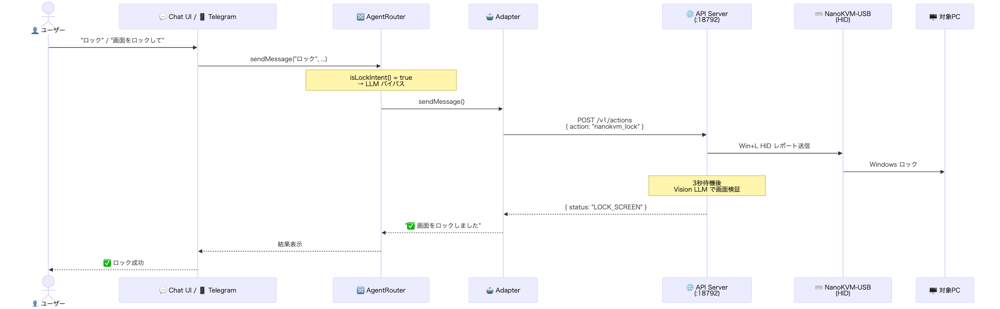

</div>

#### インテント検出

```typescript
function isLockIntent(message: string): boolean {
  const lockPatterns = /^(ロック|lock|画面をロック|screen\s*lock)/i
  return lockPatterns.test(message.trim())
}
```

**zeroclaw の場合**: zeroclaw 自体は `nanokvm_lock` ツールを持たないため、Adapter レベルで `isLockIntent()` を判定し、LLM を経由せず直接 `/v1/actions` API を呼び出す。

### 6.2 ログイン（`nanokvm_login`）

Windows ロック画面の PIN 入力解除を HID 経由で実行。

#### シーケンス（Vault 連携）

<div class="figure-block">

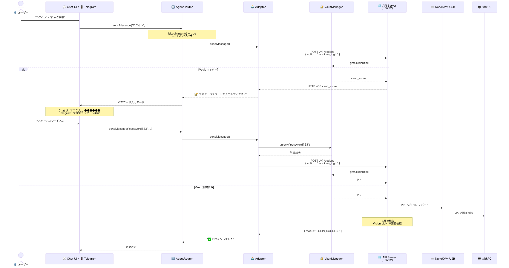

</div>

#### インテント検出

```typescript
function isLoginIntent(message: string): boolean {
  const loginPatterns = /^(ログイン|login|ロック解除|unlock)/i
  return loginPatterns.test(message.trim())
}
```

### 6.3 テキスト入力（`nanokvm_type`）

```
Type text on the remote computer (テキスト入力/文字入力).
Do NOT use for login/ログイン - use nanokvm_login instead.
Only ASCII characters are supported.
```

### 6.4 ショートカット（`nanokvm_shortcut`）

```
Send keyboard shortcuts to the remote computer.
Common shortcuts: Ctrl+Alt+Del, Alt+Tab, Alt+F4, etc.
Do NOT use this for locking - use nanokvm_lock instead.
```

### 6.5 メール送信（`nanokvm_send_email`）— 設計中

> ⚠️ 本セクションは設計段階です。実装は来週以降の予定。

Outlook デスクトップアプリを HID 操作で自動化し、メールを送信する機能。

**制約**:
- ASCII 英語のみ対応（HID キーボード経由のため日本語入力は不可）
- Outlook が対象 PC でアクティブであること
- 宛先・件名・本文の 3 パラメータをユーザーに確認後に実行

---

## 7. Credential Vault

### 7.1 設計原則

| 原則 | 実装 |
|------|------|
| LLM にパスワードを渡さない | マスターパスワードは LLM バイパスで Vault API に直接渡す |
| Telegram メッセージ即時削除 | パスワードメッセージは `deleteMessage` で即座に削除 |
| Chat UI マスク表示 | `isVaultPasswordMode` で入力欄を `type="password"` に切り替え |
| 暗号化保存 | AES-256-GCM + PBKDF2-SHA256（100K イテレーション） |
| 自動ロック | 60 秒間未使用で自動ロック |
| エージェント切替時ロック | `cleanup()` / `stop()` で Vault を自動ロック |

### 7.2 ストレージ設計

```
~/.picoclaw/vault.enc          ← AES-256-GCM 暗号化ファイル
~/.picoclaw/vault_pending.json ← 解錠待ち状態（5分で失効）
```

**暗号化仕様**:
- **アルゴリズム**: AES-256-GCM
- **鍵導出**: PBKDF2-SHA256, Salt 16 バイト, 100,000 イテレーション
- **IV**: 12 バイトランダム
- **Auth Tag**: 16 バイト

### 7.3 Vault 解錠フロー

<div class="figure-block">

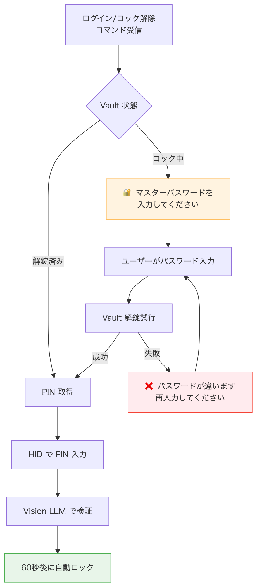

</div>

### 7.4 マスク表示の標準化

Vault がロック状態の場合、LLM の応答テキストに関わらず以下の固定メッセージを返す:

```
🔐 マスターパスワードを入力してください
```

Chat UI 側では `isVaultPasswordMode` でこの文字列を検出し、入力欄をパスワードマスクに切り替える:

```typescript
const isVaultPasswordMode = messages.length > 0 &&
  messages[messages.length - 1].role === 'assistant' &&
  messages[messages.length - 1].content.includes('マスターパスワードを入力してください')
```

### 7.5 Settings UI

Settings 画面の「🔐 ログイン認証情報」セクションで認証情報の登録・変更・削除が可能:

```
┌─── 🔐 ログイン認証情報 ─────────────────────┐
│                                              │
│  マスターパスワード:  [●●●●●●●●    ] [保存]  │
│                                              │
│  ─── 保存済み認証情報 ────────────────────    │
│  Windows PIN: ●●●●●●  [変更] [削除]          │
│                                              │
└──────────────────────────────────────────────┘
```

---

## 8. 入力チャネル

### 8.1 処理パスの統一

```
┌───────────────────────────────────────────────────────┐
│                 入力チャネル                            │
│                                                       │
│  Chat UI ──→ IPC ──┐                                  │
│                     ├──→ AgentRouter.sendMessage() ──→ │
│  Telegram ──→ TelegramService ─┘                      │
│                                                       │
│          ※ 処理パスは 1 つだけ                          │
└───────────────────────────────────────────────────────┘
```

### 8.2 Chat UI（Electron Renderer）

<div class="figure-block">

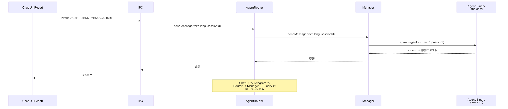

</div>

**Vault パスワードモード**: `isVaultPendingUnlock` が true の場合、入力欄が `type="password"` に切り替わり、ユーザー入力がマスク表示される。

### 8.3 Telegram Bot

<div class="figure-block">

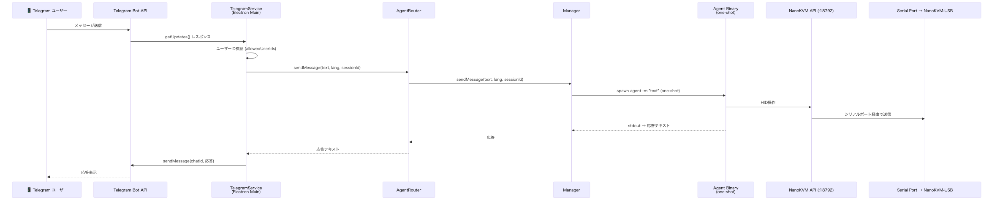

</div>

**パスワードメッセージ削除**: Vault 解錠待ち状態でユーザーがパスワードを送信した場合、`TelegramService.handleUpdate()` が `deleteMessage` API でチャット履歴からパスワードメッセージを即座に削除する。

### 8.4 Chat UI と Telegram の比較

| 機能 | Chat UI | Telegram |
|------|---------|----------|
| 入力方式 | テキストフィールド | Telegram チャット |
| パスワードマスク | `type="password"` で ●●●● 表示 | メッセージ送信後に `deleteMessage` で削除 |
| セッション ID | `chatui-default` | `telegram-{chatId}` |
| エージェント切替 | 設定画面から切替 | 切替不要（AgentRouter が自動ルーティング） |

### 8.5 TelegramService 設計

エージェントバイナリの `gateway` サブコマンドは使用しない。Electron メインプロセス内の `TelegramService` が Telegram Bot API と通信し、受信メッセージを `AgentRouter.sendMessage()` に渡す。

**主なメソッド**:

| メソッド | 説明 |
|---------|------|
| `configure(config)` | Bot Token / User ID を設定 |
| `start()` | Long-polling 開始 |
| `stop()` | Long-polling 停止 |
| `getStatus()` | `{ running: boolean }` |
| `handleUpdate(update)` | メッセージ処理 + パスワード削除 |
| `sendReply(chatId, text)` | 返信送信 |
| `deleteMessage(chatId, messageId)` | メッセージ削除 |

**エージェント切り替え時**: TelegramService はエージェント非依存のため再起動不要。AgentRouter の宛先が変わるだけで、次の Telegram メッセージから新エージェントが自動的に応答する。

---

## 9. Vision LLM（画面検証）

### 9.1 設計思想: チャット LLM と Vision LLM の分離

チャットには安価なテキスト LLM、画面検証には Vision 対応 LLM という使い分け。
両方ともアプリの設定メニューからプロバイダ・モデルを自由に選択可能。

```
💬 Chat LLM:   gpt-4.1 (GitHub Copilot 無料)
👁️ Vision LLM: gpt-4.1 (GitHub Copilot 無料) or llama-4-scout (Groq 無料)
```

> **推奨構成**: GitHub Copilot の `gpt-4.1` を Chat・Vision 両方に設定。無料で高品質。

### 9.2 検証フロー

<div class="figure-block">

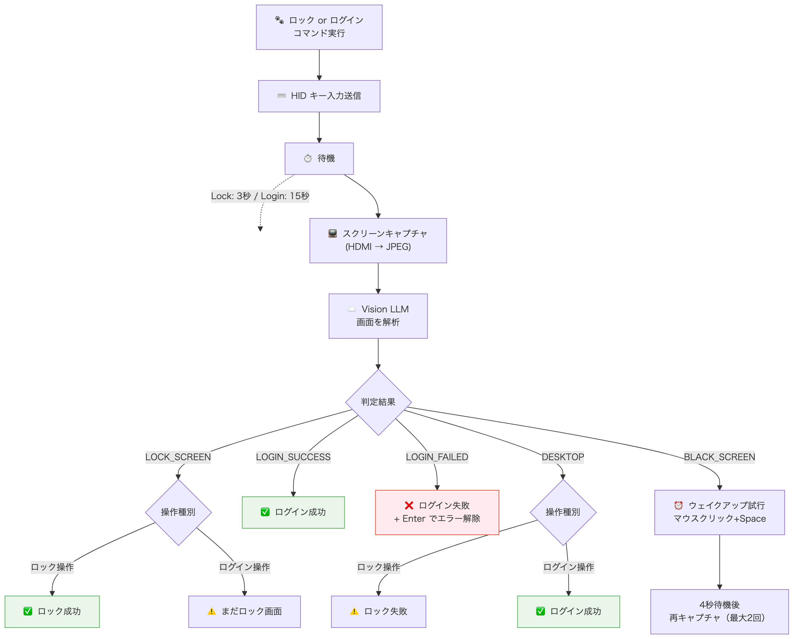

</div>

### 9.3 Vision プロンプト

| 検証タイプ | プロンプト | 期待レスポンス |
|-----------|-----------|--------------|
| ロック | "Is this a Windows lock screen or a desktop?" | `LOCK_SCREEN` / `DESKTOP` |
| ログイン | "What is the Windows login status?" | `LOGIN_SUCCESS` / `LOGIN_FAILED` / `LOCK_SCREEN` |
| ステータス | 汎用プロンプト（画面全体を記述） | 自由記述 |

> **多言語対応**: `language` 設定に応じた言語指示が自動付加（例: `language: "ja"` → 「日本語で回答してください」）

### 9.4 早期終了条件

| 結果 | 条件 | 動作 |
|------|------|------|
| ✅ 成功 | 応答に ✅ を含む | 早期終了・成功として返却 |
| ❌ 失敗 | 応答に ❌ / LOGIN_FAILED を含む | 早期終了・失敗として返却 |
| ⚠️ 未完了 | 応答に ⚠️ / LOCK_SCREEN を含む | 早期終了・警告として返却 |

### 9.5 Vision LLM 対応モデル（参考）

> 実際の UI は 3 ソースマージによる動的リストで表示されます（§10.3 参照）。

| プロバイダ | モデル | 料金 | 備考 |
|-----------|--------|------|------|
| **GitHub Copilot** | gpt-4.1 | 無料 | **推奨** |
| **Groq** | llama-4-scout | 無料 | **推奨**: 高速 |
| **Groq** | llama-4-maverick | 無料 | 高精度 |
| **Ollama** | moondream2 | 無料 | ローカル・CPU 向き |
| **OpenRouter** | gemini-2.0-flash | 安価 | 高速 |
| **OpenAI** | gpt-4o-mini | 安価 | 低コスト |
| **Anthropic** | claude-3-5-haiku | 安価 | コスト効率 |

### 9.6 Vision UI エージェント別表示

| 状態 | picoclaw 選択時 | zeroclaw 選択時 |
|---|---|---|
| **デフォルト表示** | Provider + Model ドロップダウン | 「🔗 メインモデルを画面検証に使用中」 |
| **メインモデル Vision 非対応** | —（別 LLM なので影響なし） | ⚠️ 警告 + 変更ボタン |
| **個別 Vision LLM** | 表示なし（常に個別） | 「☑ 個別の Vision LLM を使用」チェックボックス |

### 9.7 タイムアウト設定

| プロバイダ | 検証遅延 (ロック) | 検証遅延 (ログイン) | API タイムアウト |
|-----------|------------------|-------------------|----------------|
| クラウド (Groq 等) | 3 秒 | 15 秒 | 30 秒 |
| Ollama (ローカル) | 5 秒 | 15 秒 | 120 秒 |

---

## 10. 設定管理

### 10.1 設定ファイル構成

```
~/.nanoclaw/
  config.json                     ← 共通設定（agent_type, LLM 設定）
~/.picoclaw/
  config.json                     ← picoclaw 固有設定
  vault.enc                       ← Credential Vault（暗号化）
  vault_pending.json              ← Vault 解錠待ち状態
  model-update-status.json        ← モデル更新ステータス
~/.zeroclaw/
  config.toml                     ← zeroclaw 固有設定
```

### 10.2 設定同期フロー

<div class="figure-block">

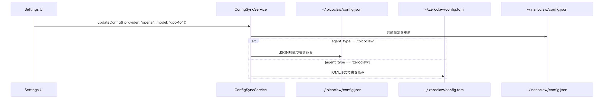

</div>

#### picoclaw → zeroclaw 設定マッピング

| 共通設定キー | picoclaw (JSON) | zeroclaw (TOML) |
|---|---|---|
| `provider` | `agents.defaults.provider` | `default_provider` |
| `model` | `agents.defaults.model` | `default_model` |
| `temperature` | `agents.defaults.temperature` | `default_temperature` |
| `maxTokens` | `agents.defaults.max_tokens` | *(CLI 引数で渡す)* |
| `visionProvider` | `agents.defaults.vision_provider` | *(model_support_vision = true)* |
| `providers.X.apiKey` | `providers.X.api_key` | 環境変数 or TOML `[providers.X]` |

#### 設定保存時の同期ルール

| フィールド | 保存時の動作 | 読み込み時の動作 |
|-----------|------------|----------------|
| `model` | `ensureProtocolPrefix()` 正規化後に書き込み | `model_name` が空の場合のフォールバック |
| `model_name` | 同一の正規化済み値で同時に書き込み | Go が **最優先** で読み取る |
| `max_tokens` | プロバイダ別に明示設定: groq=1024, github-copilot=16384, その他=16384 | — |

#### updateConfig 深層マージ

`updateConfig()` は **1 段階の深層マージ** を行い、以下のデータを保護:

| 保護対象 | 説明 |
|---------|------|
| `agents.list` | Go の複数エージェント定義 |
| `channels.discord`, `channels.slack` 等 | UI は Telegram のみ操作 |
| `channels.telegram.proxy` | 既存の proxy 設定を保持 |
| `tools`, `heartbeat`, `devices` 等 | UI が操作しないトップレベル設定 |

### 10.3 モデルリスト自動更新（3 ソースマージ）

モデルドロップダウンに表示されるモデルは、3 つのソースをマージして生成:

<div class="figure-block">

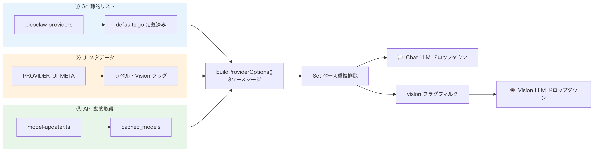

</div>

#### マージロジック

1. Go 静的リストのモデルを起点にする
2. 各モデルに UI メタデータがあれば、ラベル・説明・Vision フラグを付与
3. UI メタデータにあるが Go リストにないモデルを追加（手動キュレーション分）
4. `cached_models` にあるが 1-3 にないモデルを追加（API 検出分）
5. Set ベースの重複排除（prefixed ID と bare ID の dual-key）

#### Vision モデル自動検出

```typescript
const VISION_MODEL_PATTERNS = /vision|llava|moondream|gpt-4o|gpt-4\.1|scout|maverick|multimodal|gemini|claude-3/i
```

API 経由で発見された新モデルがこのパターンにマッチすると、Vision 対応として自動的にドロップダウンに表示される。

#### モデル更新プロバイダ対応

| プロバイダ | API エンドポイント | 認証方式 |
|-----------|-------------------|---------|
| Groq | `https://api.groq.com/openai/v1/models` | Bearer API Key |
| OpenAI | `https://api.openai.com/v1/models` | Bearer API Key |
| OpenRouter | `https://openrouter.ai/api/v1/models` | 認証不要 |
| Anthropic | `https://api.anthropic.com/v1/models` | `x-api-key` |
| DeepSeek | `https://api.deepseek.com/models` | Bearer API Key |
| Ollama | `http://localhost:11434/api/tags` | 認証不要 |
| Mistral | `https://api.mistral.ai/v1/models` | Bearer API Key |

#### スケジュール設定

| 項目 | オプション | デフォルト |
|------|----------|----------|
| 頻度 | 日次 / 週次 / 月次 | **月次** |
| 実行時刻 | 0:00〜23:00 | **0:00** |
| 有効/無効 | トグル | **有効** |

### 10.4 チャット LLM プロバイダ一覧

| プロバイダ | デフォルトモデル | 認証方式 | 料金 | 備考 |
|-----------|-----------------|---------|------|------|
| **GitHub Copilot** | gpt-4.1 | OAuth (gh CLI) | **無料** | **推奨** |
| **Groq** | llama-3.3-70b-versatile | API Key | 無料枠あり | 高速 |
| **OpenAI** | gpt-5.2 | API Key | 有料 | 高品質 |
| **Anthropic** | claude-sonnet-4.6 | API Key | 有料 | 高品質 |
| **DeepSeek** | deepseek-chat | API Key | 安価 | コスト効率 |
| **Google Gemini** | gemini-2.0-flash-exp | API Key | 無料枠あり | 高速 |
| **OpenRouter** | auto | API Key | 従量制 | 多プロバイダ統合 |
| **Ollama** | llama3 | 不要 | **無料** | ローカル実行 |

### 10.5 GitHub Copilot 認証フロー

GitHub Copilot プロバイダは [GitHub Models API](https://models.inference.ai.azure.com) を使用。
`gh auth login` で取得した OAuth トークン (`gho_*`) で認証し、API キーの手動入力は不要。

<div class="figure-block">

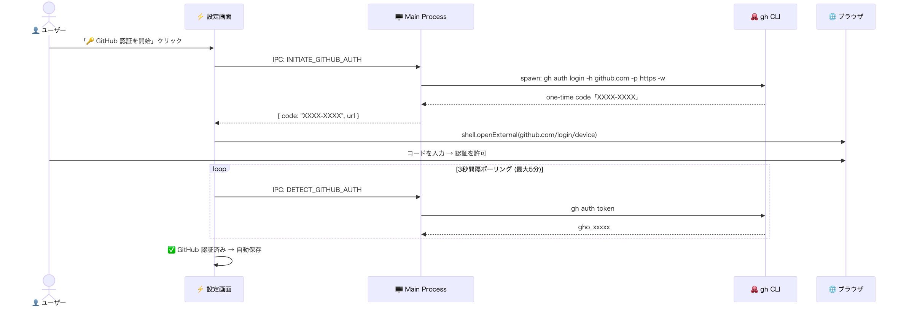

</div>

**前提条件**: GitHub CLI (`gh`) インストール済み、GitHub アカウント（無料でOK）、Copilot 登録不要。

### 10.6 known-protocols

`src/common/known-protocols.ts` に定義された `KNOWN_PROTOCOLS` Set（28 プロトコル）と
ヘルパー関数で、モデル ID のプレフィックス管理を行う:

| 関数 | 説明 |
|------|------|
| `ensureProtocolPrefix(model, provider)` | プレフィックスなしの場合に付与 |
| `stripProtocolPrefix(model)` | プレフィックスを除去 |
| `hasKnownProtocolPrefix(model)` | 既知プレフィックスの有無 |

Go 側 `pkg/config/migration.go` の `knownProtocols` マップと同期を保つ必要がある。

---

## 11. API Server

### 11.1 エンドポイント一覧

ローカル API サーバー (port 18792) のエンドポイント:

#### picoclaw 用（既存）

```
POST /api/keyboard/type      { text: "hello" }
POST /api/keyboard/shortcut  { keys: ["ctrl", "l"] }
POST /api/keyboard/login     { password: "***" }
POST /api/mouse/click        { button: "left" }
GET  /api/screen/capture
POST /api/screen/verify      { prompt: "...", action: "lock"|"login"|"status" }
```

#### zeroclaw 用（computer_use 互換）

```
POST /v1/actions
{
  "action": "<action_name>",
  "params": { ... },
  "policy": { "max_coordinate_x": 1920, "max_coordinate_y": 1080 },
  "metadata": { "session_name": "nanokvm", "source": "zeroclaw.browser" }
}
```

#### 対応アクション

| アクション | params | NanoKVM HID マッピング |
|---|---|---|
| `nanokvm_lock` | — | `Win+L` HID 送信 + Vision 検証 |
| `nanokvm_login` | — | Vault PIN → HID 入力 + Vision 検証 |
| `key_type` | `{ text: string }` | → `keyboard/type` |
| `key_press` | `{ key: string }` | → `keyboard/shortcut` |
| `screen_capture` | `{ path?: string }` | → base64 PNG |
| `mouse_move` | `{ x, y }` | → `mouse/move` |
| `mouse_click` | `{ x, y, button? }` | → `mouse/click` |
| `mouse_drag` | `{ from_x, from_y, to_x, to_y }` | → `mouse/drag` |

#### レスポンス形式

```json
{ "success": true, "data": { ... }, "error": null }
```

### 11.2 スクリーンキャプチャ（2 段階フォールバック）

```
Stage 1: Renderer IPC → canvas.toDataURL() → base64 JPEG
  ↓ 失敗時（Lock 画面で video 停止等）
Stage 2: ffmpeg → HDMI キャプチャデバイスから直接取得
```

**ffmpeg バンドル**: `ffmpeg-static` npm パッケージでアプリ内にバンドル済み。macOS AVFoundation + Windows DirectShow のクロスプラットフォーム対応。

### 11.3 黒画面検出 & 自動ウェイク

- 輝度閾値 `avgBrightness < 15` → `BLACK_SCREEN` 判定
- マウスクリック + キーボード Space → 4 秒待機 → 再キャプチャ（最大 2 回リトライ）
- `NO_VIDEO`（デバイス未接続）と `BLACK_SCREEN`（スリープ/HDMI 再取得中）を区別

---

## 12. 制約事項・レートリミット

### 12.1 HID 制約

| 制約 | 値 |
|------|-----|
| 同時押しキー数 | 最大 4（修飾キー除く） |
| テキスト入力 | ASCII のみ |
| マウスボタン | Left=0x01, Right=0x02, Middle=0x04（ビットフラグ） |
| マウスレポート | 5 バイト: `[0x01, buttons, deltaX, deltaY, scroll]` |

### 12.2 レートリミット対策

| 対策 | 対象 | 説明 |
|------|------|------|
| One-Shot 方式 | 全プロバイダ | セッション蓄積なし → トークン消費を最小化 |
| 早期終了 | 全プロバイダ | ✅/❌/⚠️ で即座に返却 |
| NanoKVM 回数制限 | 全プロバイダ | 1 メッセージあたり最大 4 回 |
| Intent 検出 LLM バイパス | 全プロバイダ | ロック/ログインは LLM を経由せず直接 API 呼び出し |
| REDACTED 拒否 | 全プロバイダ | LLM がパスワードをマスクした場合は実行拒否 |
| 429 ポップアップ | 全プロバイダ | レートリミット時にリトライ待ち時間を UI に表示 |
| Heartbeat 429 バックオフ | 全プロバイダ | 429 受信時に最低 30 分間 heartbeat を一時停止 |
| max_tokens 制限 | 全プロバイダ | プロバイダ別に自動設定 |
| prompt_cache_key | OpenAI/GitHub Models のみ | 非対応プロバイダでは送信しない（ホワイトリスト方式） |

### 12.3 GitHub Models API レート制限

| 項目 | 値 |
|------|----|
| エンドポイント | `https://models.inference.ai.azure.com/chat/completions` |
| 認証 | GitHub PAT / `gh auth token` を Bearer トークン |
| 無料枠 | 100 回/日/モデル |
| 有料枠 | GitHub Models Marketplace で拡張可能 |

### 12.4 Heartbeat サービス

picoclaw gateway は 30 分間隔で heartbeat を実行。429 受信時:
1. `Retry-After` / `Please wait N seconds` / `try again in N.Ns` パターンで待機時間を抽出
2. 最低 30 分のバックオフを適用
3. バックオフ期間中の heartbeat はスキップ

### 12.5 リスク・考慮事項

| リスク | 対策 |
|---|---|
| zeroclaw computer_use API が非互換 | API フォーマット事前調査・互換レイヤー実装 |
| バイナリサイズ (~17MB 合計) | 許容範囲内 |
| 設定同期の競合 | ファイルロック、タイムスタンプチェック |
| 各プラットフォームのバイナリ提供 | GitHub Actions でマルチプラットフォームビルド |

---

## 13. 変更履歴

### NanoKVM-USB Desktop (v2026.03.08 — スペック統合)

| 変更 | 内容 |
|------|------|
| **nanoclaw-spec.md 作成** | `picoclaw-lock-login-spec.md` と `multi-agent-spec.md` を統合した単一仕様書を新規作成 |
| **Intent ベース LLM バイパス** | zeroclaw adapter に `isLockIntent()` / `isLoginIntent()` 判定を追加。ロック/ログイン操作は LLM を経由せず `/v1/actions` API を直接呼び出し |
| **Vault マスク標準化** | Vault ロック時の応答を固定メッセージ `"🔐 マスターパスワードを入力してください"` に統一。Chat UI のマスク検出と完全一致 |
| **Vault 60 秒自動ロック** | `unlock()` 後 60 秒で自動ロック。エージェント切替時も `cleanup()` / `stop()` で即座にロック |
| **zeroclaw 全テスト合格** | zeroclaw + picoclaw × ChatUI + Telegram × ロック + ログイン の全 8 シナリオでテスト合格 |

### NanoKVM-USB Desktop (v2026.03.02e)

| 変更 | 内容 |
|------|------|
| **sendMouse() HID フォーマット修正** | 3 バイト → 5 バイト `[0x01, buttons, deltaX, deltaY, scroll]` に修正 |
| **heartbeat バックオフ改善** | `parseRetryAfter` 正規表現改善。Groq 形式 `try again in N.Ns` 対応 |

### NanoKVM-USB Desktop (v2026.03.02)

| 変更 | 内容 |
|------|------|
| **Credential Vault 実装** | AES-256-GCM + PBKDF2-SHA256 暗号化。IPC イベント 8 個追加 |
| **3 ソースマージアーキテクチャ** | Go 静的リスト + UI メタデータ + API 動的取得の 3 ソースマージ |
| **Vision モデル自動検出** | `VISION_MODEL_PATTERNS` + `isLikelyVisionModel()` |
| **Vision LLM 動的ドロップダウン** | 静的 `VISION_PROVIDERS` 削除 → 動的フィルタリング |
| **model-updater 全プロバイダ更新** | API キー設定済みの全プロバイダを常にチェック |
| **known-protocols.ts** | 28 プロトコルの共有モジュール新規作成 |
| **max_tokens プロバイダ別設定** | groq=1024, github-copilot=16384, その他=16384 |
| **updateConfig 深層マージ** | 他チャンネル設定の消失を防止 |

### NanoKVM-USB Desktop (v2026.02.27)

| 変更 | 内容 |
|------|------|
| **ログイン速度最適化** | 14 秒 → 5 秒（skipWake, PIN 待機短縮, 文字入力遅延短縮） |
| **Vision 言語対応** | Vision LLM プロンプトに言語指示を自動付加 |
| **ffmpeg バンドル** | アプリ内に ffmpeg バイナリをバンドル |
| **Windows ffmpeg 対応** | macOS AVFoundation + Windows DirectShow クロスプラットフォーム |
| **Credential Vault 設計書** | セキュリティセクション新設 |

### picoclaw Go (v2026.03.02)

| 変更 | 内容 |
|------|------|
| **Groq モデル追加** | llama-3.1-8b-instant, llama-4-scout, llama-4-maverick, llama-3.2-11b-vision |
| **vault_pending_unlock** | `cmd_gateway.go` に Vault 解錠フロー実装 |
| **Heartbeat 429 バックオフ** | `Retry-After` 解析 + 最低 30 分バックオフ |
| **prompt_cache_key ホワイトリスト** | OpenAI + GitHub Models のみ送信 |

### picoclaw Go (upstream マージ — v0.2.0)

| 変更 | 内容 |
|------|------|
| **Channel System リファクタ** | ファクトリレジストリ、サブパッケージ化、BaseChannel 抽象化 |
| **MessageBus 改善** | バッファ 16→64、`PublishOutbound` に ctx 引数追加 |
| **FileMediaStore** | TTL ベース自動クリーンアップ |
| **セッション履歴自動修復** | tool_calls 対応 tool レスポンス欠落時のトランケート |
| **BLACK_SCREEN / 自動ウェイク** | 黒画面検出 → マウス+キーボード → 再キャプチャ |

### NanoKVM-USB (upstream)

| 変更 | 内容 |
|------|------|
| **Right Shift 修正** | `normalizeKeyCode()` フォールバック |
| **セキュリティ依存更新** | minimatch, tar, ajv 脆弱性対応 |
