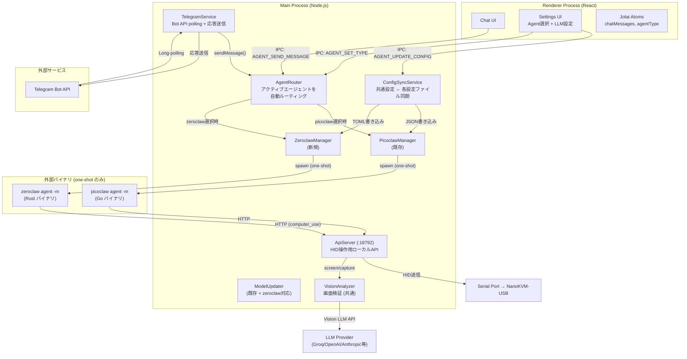
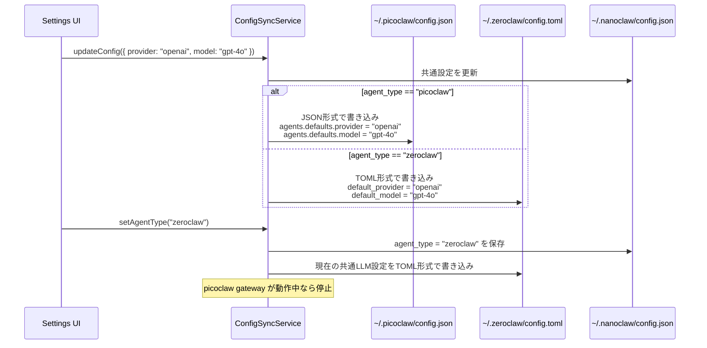
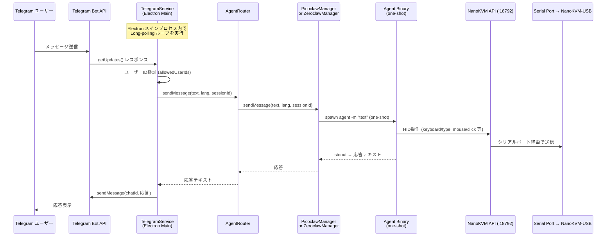
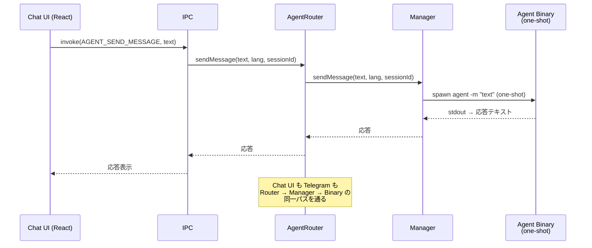
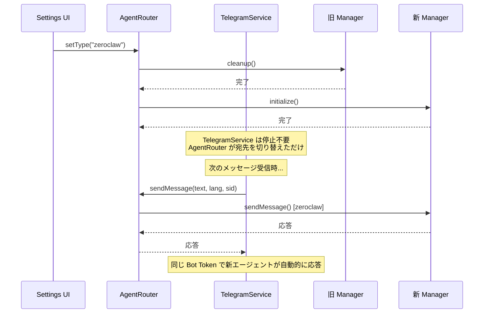
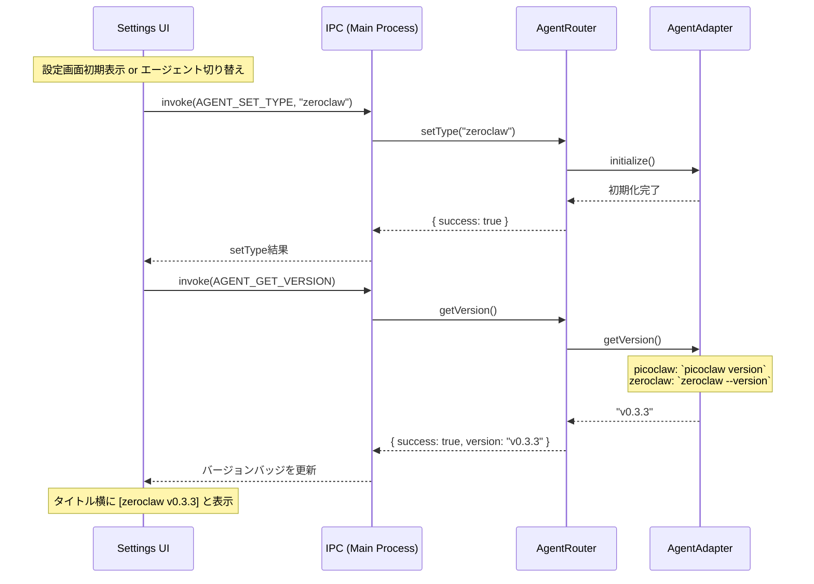

# マルチ AI エージェント対応仕様書

> **作成日**: 2026-03-06 (v2026.03.06c — Telegram 統一処理パス設計)  
> **ステータス**: ドラフト — 実装準備完了

## 概要

NanoKVM-USB デスクトップアプリの AI エージェント機能を拡張し、既存の **picoclaw**（Go製）に加えて **zeroclaw**（Rust製）を選択可能にする。設定メニューでエージェントを切り替え、LLM 選択・API キー設定・プロンプトは共通化して利用する。

**設計方針**:
- 排他切り替え式（同時に1つのエージェントのみアクティブ）
- LLM プロバイダー/モデル/API キー設定は UI で共通管理
- 各エージェントの固有設定ファイルに自動同期
- Chat UI・プロンプトは共通利用
- ローカル API サーバー（port 18792）を両エージェントで共有
- **メッセージ処理の統一**: Chat UI と Telegram の 2 つの入力ルートがあるが、処理パスは 1 つに統一する。2 つのソースに分岐させるとコードもバグも倍増するため、`AgentRouter.sendMessage()` を唯一の処理パスとし、Telegram はその入力チャネルの 1 つとして Electron メインプロセス内の `TelegramService` が担う

---

## 1. picoclaw と zeroclaw の比較

| 項目 | picoclaw | zeroclaw |
|---|---|---|
| **言語** | Go | Rust |
| **メモリ** | < 10MB | < 5MB |
| **起動時間** | < 1s | < 10ms |
| **バイナリ配布** | `resources/bin/picoclaw` にバンドル | `resources/bin/zeroclaw` にバンドル |
| **設定形式** | JSON (`~/.picoclaw/config.json`) | TOML (`~/.zeroclaw/config.toml`) |
| **Agent CLI** | `picoclaw agent -m "msg" -l lang -s session` | `zeroclaw agent -m "msg" --provider <ID> --model <MODEL>` |
| **Version CLI** | `picoclaw version` → `picoclaw v0.1.2-26-gc123ba8 (git: ...)` | `zeroclaw --version` → `zeroclaw 0.3.3` |
| **Gateway CLI** | `picoclaw gateway` | `zeroclaw gateway` |
| **Gateway 利用** | 不使用（TelegramService に統一） | 不使用（TelegramService に統一） |
| **プロバイダー一覧** | `picoclaw providers` (JSON) | `zeroclaw providers` |
| **モデル更新** | `picoclaw` 内蔵 ModelUpdater | `zeroclaw models refresh` |
| **設定キー(LLM)** | `agents.defaults.provider/model` | `default_provider` / `default_model` |
| **Vision** | 独立設定 `vision_provider/vision_model` | `model_support_vision` (bool) + プロバイダーのVision対応に依存 |
| **HID 操作** | カスタム HTTP API (port 18792) | `[browser.computer_use]` endpoint |
| **ツール** | カスタムツール（keyboard/type, shortcut, login, mouse/click 等） | 組み込みツール（shell, file_read, browser, computer_use 等） |
| **ライセンス** | プロプライエタリ | MIT / Apache-2.0 |

---

## 2. アーキテクチャ

### 2.1 全体構成

**メッセージ処理の統一原則**: Chat UI と Telegram の 2 つの入力ルートがあるが、メッセージ処理パスは `AgentRouter.sendMessage()` に一本化する。エージェントバイナリの gateway サブコマンドは使用せず、常に one-shot モード（`agent -m`）で呼び出す。Telegram Bot API 通信は Electron メインプロセス内の `TelegramService` が担当し、受信したメッセージを AgentRouter 経由で処理する。



### 2.2 共通インターフェース: AgentAdapter

```typescript
interface AgentAdapter {
  /** エージェント種別 */
  readonly type: 'picoclaw' | 'zeroclaw'

  /** Agent one-shot メッセージ送信（Chat UI / Telegram 共通） */
  sendMessage(message: string, language: string, sessionId: string): Promise<string>

  /** バージョン取得 — エージェント切り替え時に自動呼び出しされ UI バッジに表示 */
  getVersion(): Promise<string>

  /** サポートプロバイダー一覧取得 */
  getProviders(): Promise<ProviderInfo[]>

  /** 設定読み込み（共通形式に変換） */
  getConfig(): Promise<CommonAgentConfig>

  /** 設定書き込み（共通形式→固有形式に変換） */
  updateConfig(config: Partial<CommonAgentConfig>): Promise<void>

  /** エージェント固有の初期化 */
  initialize(): Promise<void>

  /** エージェント固有のクリーンアップ */
  cleanup(): Promise<void>
}
```

> **注**: Gateway（Telegram bot）の起動・停止は `AgentAdapter` の責務ではない。
> Telegram Bot API 通信はエージェント非依存の `TelegramService` が一元管理し、
> 受信メッセージは `AgentRouter.sendMessage()` 経由で処理する。

### 2.3 共通設定型

```typescript
interface CommonAgentConfig {
  /** LLM プロバイダー */
  provider: string
  /** LLM モデル */
  model: string
  /** モデル表示名 */
  modelName: string
  /** API キー (プロバイダー別) */
  providers: Record<string, { apiKey: string; apiBase: string }>
  /** Vision プロバイダー */
  visionProvider?: string
  /** Vision モデル */
  visionModel?: string
  /** 個別Vision LLMを使用するか (zeroclaw時のみ意味を持つ) */
  useSeperateVisionLlm?: boolean
  /** Temperature */
  temperature: number
  /** Max tokens */
  maxTokens: number
  /** Telegram 設定 */
  telegram?: {
    botToken: string
    userId: string
    enabled: boolean
  }
  /** 利用可能モデル一覧 (キャッシュ) */
  cachedModels?: ProviderModels[]
}
```

---

## 3. 設定の同期

### 3.1 設定ファイル構成

```
~/.nanoclaw/                      ← 新規: NanoKVM共通設定
  config.json                     ← agent_type, 共通LLM設定
~/.picoclaw/
  config.json                     ← picoclaw固有設定（既存）
~/.zeroclaw/
  config.toml                     ← zeroclaw固有設定
```

### 3.2 NanoKVM共通設定 (`~/.nanoclaw/config.json`)

```json
{
  "agent_type": "picoclaw",
  "agents": {
    "defaults": {
      "provider": "groq",
      "model": "groq/llama-3.1-8b-instant",
      "model_name": "groq/llama-3.1-8b-instant",
      "vision_provider": "groq",
      "vision_model": "meta-llama/llama-4-scout-17b-16e-instruct",
      "temperature": 0.7,
      "max_tokens": 1024
    }
  },
  "providers": {
    "groq": { "api_key": "gsk_...", "api_base": "" }
  }
}
```

### 3.3 同期のフロー



### 3.4 picoclaw → zeroclaw 設定マッピング

| 共通設定キー | picoclaw (JSON) | zeroclaw (TOML) |
|---|---|---|
| `provider` | `agents.defaults.provider` | `default_provider` |
| `model` | `agents.defaults.model` | `default_model` |
| `temperature` | `agents.defaults.temperature` | `default_temperature` |
| `maxTokens` | `agents.defaults.max_tokens` | *(CLI引数で渡す)* |
| `visionProvider` | `agents.defaults.vision_provider` | *(Vision対応モデルをdefaultに設定)* |
| `visionModel` | `agents.defaults.vision_model` | *(model_support_vision = true)* |
| `providers.X.apiKey` | `providers.X.api_key` | 環境変数 or TOML `[providers.X]` |
| `providers.X.apiBase` | `providers.X.api_base` | TOML `[providers.X]` |
| `telegram.botToken` | *(不要 — TelegramService が直接管理)* | *(不要 — TelegramService が直接管理)* |
| `telegram.userId` | *(不要 — TelegramService が直接管理)* | *(不要 — TelegramService が直接管理)* |

---

## 4. バイナリ管理

### 4.1 ディレクトリ構成

```
resources/bin/
  picoclaw          ← 既存（Go製）
  zeroclaw          ← 新規（Rust製）
```

### 4.2 バイナリパス解決

```typescript
function getAgentBinaryPath(agentType: 'picoclaw' | 'zeroclaw'): string {
  const isDev = !app.isPackaged
  const binaryName = agentType
  if (isDev) {
    return path.join(app.getAppPath(), 'resources', 'bin', binaryName)
  }
  return path.join(process.resourcesPath, 'bin', binaryName)
}
```

### 4.3 ビルド時のバイナリ取得

- **picoclaw**: 既存のワークフロー（リポジトリに同梱）
- **zeroclaw**: ビルド時に GitHub Releases からダウンロード、または `cargo install` でビルド
  - `electron-builder.yml` の `extraResources` に `resources/bin/zeroclaw` を追加
  - アーキテクチャ別（macOS arm64/x86_64, Windows x64, Linux x64/arm64）

---

## 5. HID 操作の統合

### 5.1 picoclaw（既存）

picoclaw はカスタム HTTP エンドポイントを使用:

```
POST /api/keyboard/type      { text: "hello" }
POST /api/keyboard/shortcut  { keys: ["ctrl", "l"] }
POST /api/keyboard/login     { password: "***" }
POST /api/mouse/click        { button: "left" }
GET  /api/screen/capture
POST /api/screen/verify      { prompt: "..." }
```

### 5.2 zeroclaw（新規）

zeroclaw は `[browser.computer_use]` の sidecar プロトコルを使用。リクエストは `action` + `params` + オプショナルの `policy` / `metadata` で構成:

```json
POST /v1/actions
{
  "action": "key_type",
  "params": { "text": "hello" },
  "policy": { "max_coordinate_x": 1920, "max_coordinate_y": 1080 },
  "metadata": { "session_name": "nanokvm", "source": "zeroclaw.browser" }
}
```

レスポンス形式:
```json
{ "success": true, "data": { ... }, "error": null }
```

### 5.3 API サーバーの拡張

既存の API サーバー (port 18792) に zeroclaw computer_use 互換エンドポイントを追加。アクション名とパラメータ構造は zeroclaw の `browser.rs` ソースコードに基づく:

```typescript
// 新規エンドポイント: zeroclaw computer_use 互換
'POST /v1/actions': async (body: ComputerUseRequest) => {
  switch (body.action) {
    case 'key_type':        // { text: string } (最大4096文字)
      return handleKeyboardType({ text: body.params?.text })
    case 'key_press':       // { key: string } (1-32文字, キー名)
      return handleKeyboardShortcut({ key: body.params?.key })
    case 'screen_capture':  // { path?: string } → base64 PNG レスポンス
      return handleScreenCapture()
    case 'mouse_move':      // { x: number, y: number }
      return handleMouseMove({ x: body.params?.x, y: body.params?.y })
    case 'mouse_click':     // { x: number, y: number, button?: "left"|"right"|"middle" }
      return handleMouseClick({
        x: body.params?.x, y: body.params?.y,
        button: body.params?.button || 'left'
      })
    case 'mouse_drag':      // { from_x, from_y, to_x, to_y }
      return handleMouseDrag(body.params)
    default:
      return { success: false, error: `Unknown action: ${body.action}` }
  }
}
```

### 5.4 zeroclaw 設定への反映

zeroclaw の `config.toml` に以下を自動設定:

```toml
[browser]
enabled = true
backend = "computer_use"

[browser.computer_use]
endpoint = "http://127.0.0.1:18792/v1/actions"

[autonomy]
level = "full"
allowed_commands = ["*"]
```

---

## 5.5 Telegram 統合（TelegramService）

### 設計原則

メッセージ処理パスを一本化するため、エージェントバイナリの `gateway` サブコマンドは使用しない。代わりに、Electron メインプロセス内の `TelegramService` が Telegram Bot API と通信し、受信メッセージを `AgentRouter.sendMessage()` に渡す。これにより Chat UI と Telegram は同じ処理パスを共有し、コードとバグの重複を排除する。

```
┌───────────────────────────────────────────────────────┐
│                 入力チャネル                            │
│                                                       │
│  Chat UI ──→ IPC ──┐                                  │
│                     ├──→ AgentRouter.sendMessage() ──→ │
│  Telegram ──→ TelegramService ─┘                      │
│                                                       │
│          ※ 処理パスは 1 つだけ                          │
└───────────────────────────────────────────────────────┘
```

### メッセージフロー



### Chat UI との比較



### TelegramService クラス設計

```typescript
class TelegramService {
  private polling = false
  private pollTimeout: NodeJS.Timeout | null = null
  private lastUpdateId = 0
  private botToken = ''
  private allowedUserIds: string[] = []
  private agentRouter: AgentRouter

  constructor(agentRouter: AgentRouter) {
    this.agentRouter = agentRouter
  }

  /** Telegram Bot の設定を更新 */
  configure(config: { botToken: string; userId: string }): void {
    this.botToken = config.botToken
    this.allowedUserIds = [config.userId]
  }

  /** Long-polling 開始 */
  async start(): Promise<void> {
    if (this.polling || !this.botToken) return
    this.polling = true
    console.log('[TelegramService] Starting long-polling...')
    this.pollLoop()
  }

  /** Long-polling 停止 */
  async stop(): Promise<void> {
    this.polling = false
    if (this.pollTimeout) {
      clearTimeout(this.pollTimeout)
      this.pollTimeout = null
    }
    console.log('[TelegramService] Stopped.')
  }

  /** ステータス取得 */
  getStatus(): { running: boolean } {
    return { running: this.polling }
  }

  /** メインポーリングループ */
  private async pollLoop(): Promise<void> {
    while (this.polling) {
      try {
        const updates = await this.getUpdates()
        for (const update of updates) {
          await this.handleUpdate(update)
        }
      } catch (err) {
        console.error('[TelegramService] Poll error:', err)
        // エラー後の再試行間隔
        await this.sleep(5000)
      }
    }
  }

  /** Telegram getUpdates API 呼び出し */
  private async getUpdates(): Promise<TelegramUpdate[]> {
    const url = `https://api.telegram.org/bot${this.botToken}/getUpdates`
    const resp = await fetch(url, {
      method: 'POST',
      headers: { 'Content-Type': 'application/json' },
      body: JSON.stringify({
        offset: this.lastUpdateId + 1,
        timeout: 30,  // long-polling タイムアウト (秒)
        allowed_updates: ['message']
      })
    })
    const data = await resp.json()
    if (!data.ok) throw new Error(`Telegram API error: ${data.description}`)
    return data.result || []
  }

  /** 受信メッセージを処理 — AgentRouter 経由で統一処理 */
  private async handleUpdate(update: TelegramUpdate): Promise<void> {
    this.lastUpdateId = Math.max(this.lastUpdateId, update.update_id)
    const msg = update.message
    if (!msg?.text) return

    // ユーザーID チェック
    const userId = String(msg.from?.id)
    if (!this.allowedUserIds.includes(userId)) {
      console.log(`[TelegramService] Ignored message from unauthorized user: ${userId}`)
      return
    }

    try {
      // === 統一処理パス: AgentRouter.sendMessage() ===
      const sessionId = `telegram-${msg.chat.id}`
      const response = await this.agentRouter.sendMessage(msg.text, 'ja', sessionId)
      await this.sendReply(msg.chat.id, response)
    } catch (err) {
      const errorMsg = err instanceof Error ? err.message : String(err)
      console.error('[TelegramService] Message handling error:', errorMsg)
      await this.sendReply(msg.chat.id, `⚠️ エラーが発生しました: ${errorMsg}`)
    }
  }

  /** Telegram に返信 */
  private async sendReply(chatId: number, text: string): Promise<void> {
    const url = `https://api.telegram.org/bot${this.botToken}/sendMessage`
    await fetch(url, {
      method: 'POST',
      headers: { 'Content-Type': 'application/json' },
      body: JSON.stringify({ chat_id: chatId, text })
    })
  }

  private sleep(ms: number): Promise<void> {
    return new Promise(resolve => { this.pollTimeout = setTimeout(resolve, ms) })
  }
}

// 型定義
interface TelegramUpdate {
  update_id: number
  message?: {
    message_id: number
    from?: { id: number; first_name: string }
    chat: { id: number; type: string }
    text?: string
  }
}
```

### エージェント切り替え時の動作

TelegramService はエージェント非依存のため、エージェント切り替え時に再起動は不要。AgentRouter の切り替えだけで、次の Telegram メッセージから新エージェントが応答する。



### Telegram 設定の共通管理

Telegram の設定（Bot Token, User ID）は `CommonAgentConfig.telegram` に格納され、`TelegramService.configure()` に直接渡される。エージェント固有の設定ファイルへの Telegram 設定書き込みは不要（`gateway` サブコマンドを使用しないため）。

---

## 6. ZeroclawManager 実装

### 6.1 クラス設計

```typescript
class ZeroclawManager implements AgentAdapter {
  readonly type = 'zeroclaw'
  private configPath: string  // ~/.zeroclaw/config.toml
  private binaryPath: string

  /** バージョン取得 — `zeroclaw --version` を実行してパース */
  async getVersion(): Promise<string> {
    return new Promise((resolve) => {
      try {
        const proc = spawn(this.binaryPath, ['--version'], { stdio: 'pipe' })
        let output = ''
        proc.stdout?.on('data', (data) => { output += data.toString() })
        proc.on('close', () => {
          // Parse "zeroclaw 0.3.3" → "v0.3.3"
          const match = output.match(/zeroclaw\s+([\d][^\s]*)/) 
          resolve(match ? `v${match[1]}` : 'unknown')
        })
        proc.on('error', () => resolve('unknown'))
      } catch {
        resolve('unknown')
      }
    })
  }

  /** Agent one-shot メッセージ送信（Chat UI / Telegram 共通） */
  async sendMessage(message: string, language: string, sessionId: string): Promise<string> {
    // zeroclaw agent -m "message"
    // 言語はシステムプロンプト経由で制御
    const args = ['agent', '-m', message]
    return this.spawnAndCollect(args)
  }

  // NOTE: Gateway (Telegram) は TelegramService が一元管理するため
  // ZeroclawManager には startGateway() / stopGateway() は不要

  /** 設定書き込み (CommonAgentConfig → TOML) */
  async updateConfig(config: Partial<CommonAgentConfig>): Promise<void> {
    const toml = this.convertToToml(config)
    await fs.writeFile(this.configPath, toml)
  }

  /** TOML 設定ファイル生成 */
  private convertToToml(config: Partial<CommonAgentConfig>): string {
    // CommonAgentConfig → zeroclaw config.toml フォーマット
    let toml = `
default_provider = "${config.provider}"
default_model = "${config.model}"
default_temperature = ${config.temperature}
`
    // Vision: 個別Vision LLMが未設定の場合、メインモデルのVision対応を有効化
    if (!config.useSeperateVisionLlm) {
      toml += `model_support_vision = true\n`
    }

    // NOTE: Telegram 設定は TelegramService が直接管理するため
    // zeroclaw の config.toml には書き込まない (gateway サブコマンド不使用)

    toml += `
[browser]
enabled = true
backend = "computer_use"

[browser.computer_use]
endpoint = "http://127.0.0.1:18792/v1/actions"

[autonomy]
level = "full"
allowed_commands = ["*"]
`
    return toml
  }
}
```

---

## 7. IPC イベント設計

### 7.1 新規/変更 IPC イベント

既存の `PICOCLAW_*` イベントは後方互換のため維持し、新しい抽象化レイヤーを追加:

```typescript
enum IpcEvents {
  // === 既存 (picoclaw固有 — 後方互換) ===
  PICOCLAW_START = 'picoclaw:start',
  PICOCLAW_STOP = 'picoclaw:stop',
  // ... 既存イベントはすべてそのまま

  // === 新規: エージェント共通 ===
  AGENT_GET_TYPE = 'agent:getType',           // 現在のエージェント種別取得
  AGENT_SET_TYPE = 'agent:setType',           // エージェント切り替え
  AGENT_SEND_MESSAGE = 'agent:sendMessage',   // 共通メッセージ送信
  AGENT_GET_CONFIG = 'agent:getConfig',       // 共通設定取得
  AGENT_UPDATE_CONFIG = 'agent:updateConfig', // 共通設定更新
  AGENT_GET_VERSION = 'agent:getVersion',     // バージョン取得
  AGENT_GET_PROVIDERS = 'agent:getProviders', // プロバイダー一覧
  AGENT_GET_STATUS = 'agent:getStatus',       // エージェント状態

  // === 新規: Telegram (エージェント非依存) ===
  TELEGRAM_START = 'telegram:start',          // TelegramService 開始
  TELEGRAM_STOP = 'telegram:stop',            // TelegramService 停止
  TELEGRAM_STATUS = 'telegram:status',        // TelegramService 状態

  // === 新規: zeroclaw 固有（必要に応じて追加） ===
  ZEROCLAW_MODELS_REFRESH = 'zeroclaw:modelsRefresh',
}
```

### 7.2 AgentRouter（IPC ディスパッチャー）

```typescript
class AgentRouter {
  private activeType: AgentType = 'picoclaw'
  private adapters: Record<AgentType, AgentAdapter>

  get active(): AgentAdapter {
    return this.adapters[this.activeType]
  }

  async setType(type: AgentType): Promise<void> {
    await this.active.cleanup()
    this.activeType = type
    await this.active.initialize()
    // NOTE: TelegramService は停止不要 — AgentRouter の宛先が変わるだけ
  }

  /** バージョン取得 — アクティブエージェントに委譲 */
  async getVersion(): Promise<string> {
    return this.active.getVersion()
  }

  /**
   * メッセージ送信 — Chat UI / TelegramService 共通の唯一の処理パス
   * どちらのチャネルから呼ばれても同じ AgentAdapter.sendMessage() に委譲する
   */
  async sendMessage(message: string, language: string, sessionId: string): Promise<string> {
    return this.active.sendMessage(message, language, sessionId)
  }
}
```

---

## 8. UI 変更

### 8.1 設定画面: エージェント選択

Settings タブ「AI Assistant」の最上部にエージェント選択ドロップダウンを追加:

```
┌─────────────────────────────────────────────┐
│  🤖 AI Assistant              [picoclaw v0.1.2] │
│                                             │
│  AI Agent:  [picoclaw ▼]                    │
│             ┌──────────────────┐            │
│             │ ⚙️ picoclaw      │            │
│             │ 🦀 zeroclaw     │            │
│             └──────────────────┘            │
│                                             │
│  ─── LLM Settings ───────────────────────   │
│  Provider:  [Groq ▼]                        │
│  API Key:   [gsk_***       ] [📋] [🔗]     │
│  Model:     [llama-3.1-8b ▼]               │
│                                             │
│  ─── 👁️ Vision LLM (画面検証) ────────────   │
│  ┌─ picoclaw 選択時 ─────────────────────┐  │
│  │ Provider:  [Groq ▼]                   │  │
│  │ Model:     [llama-4-scout ▼]          │  │
│  └───────────────────────────────────────┘  │
│  ┌─ zeroclaw 選択時 ─────────────────────┐  │
│  │ 🔗 メインモデルを画面検証に使用中      │  │
│  │ ℹ️ 画面検証にはVision対応モデルが      │  │
│  │   必要です (現在: llama-3.1-8b ⚠️)     │  │
│  │ [Vision対応モデルに変更...]             │  │
│  │ ── または ──                           │  │
│  │ ☑ 個別のVision LLMを使用              │  │
│  │   Provider:  [Groq ▼]                 │  │
│  │   Model:     [llama-4-scout ▼]        │  │
│  └───────────────────────────────────────┘  │
│                                             │
│  ─── 📡 Telegram ────────────────────────   │
│  Bot Token: [***         ]                  │
│  User ID:   [123456789   ]                  │
│  [Start] [Stop]  Status: ● Running          │
│  ℹ️ エージェント切り替え時も再起動不要      │
│                                             │
│  ─── Model Auto-Update ─────────────────   │
│  ...                                        │
└─────────────────────────────────────────────┘
```

### 8.2 バージョン表示の動作フロー

エージェント選択時に自動的にバージョンを読み出して UI に反映する:



**UI 実装ポイント**:
- `agentTypeAtom` の変更を `useEffect` で監視し、変更時に `AGENT_GET_VERSION` を呼び出す
- バージョン表示は現在の `picoclawVersion` state を `agentVersion` にリネームし汎用化
- バッジのテキストは `{agentType} {version}` の形式で表示（例: `picoclaw v0.1.2`, `zeroclaw v0.3.3`）
- バイナリが見つからない/実行失敗の場合は `unknown` が返るため、バッジを非表示にする

```tsx
// 設定画面のバージョン表示（既存の picoclawVersion を汎用化）
const [agentVersion, setAgentVersion] = useState<string>('')
const [agentType] = useAtom(agentTypeAtom)

useEffect(() => {
  loadVersion()
}, [agentType])  // エージェント切り替え時にバージョン再読み込み

async function loadVersion(): Promise<void> {
  try {
    const result = await window.electron.ipcRenderer.invoke(IpcEvents.AGENT_GET_VERSION)
    if (result.success && result.version) {
      setAgentVersion(result.version)
    } else {
      setAgentVersion('')
    }
  } catch (err) {
    console.error('Failed to load agent version:', err)
    setAgentVersion('')
  }
}

// JSX
<h2 className="text-xl font-semibold">{t('settings.picoclaw.title')}</h2>
{agentVersion && (
  <span className="rounded bg-neutral-700 px-2 py-0.5 text-xs text-neutral-400">
    {agentType} {agentVersion}
  </span>
)}
```

Chat ウィンドウのヘッダーに現在のエージェント名を表示:

```
┌─ Chat (picoclaw) ──────── ✕ ─┐
│                               │
│ 🤖 Hello! How can I help?    │
│                               │
│ ─────────────────────────     │
│ [Type a message...      ] [→] │
└───────────────────────────────┘
```

### 8.4 i18n キー追加

```typescript
// 新規 i18n キー
'settings.picoclaw.title': 'AI Assistant',  // "(Picoclaw)" を削除
'settings.picoclaw.agentType': 'AI Agent',
'settings.picoclaw.agentType.picoclaw': 'picoclaw (Go)',
'settings.picoclaw.agentType.zeroclaw': 'zeroclaw (Rust)',
'settings.picoclaw.agentType.hint': 'Select AI agent backend',
'settings.picoclaw.agentVersion': '{agent} {version}',  // バージョンバッジ表示
'settings.picoclaw.vision.title': 'Screen Verification Vision LLM',
'settings.picoclaw.vision.usingMainModel': 'Using main model for screen verification',
'settings.picoclaw.vision.mainModelNotVision': 'Current main model does not support Vision. Screen verification may not work.',
'settings.picoclaw.vision.switchToVisionModel': 'Switch to a Vision-capable model',
'settings.picoclaw.vision.useSeparateVision': 'Use a separate Vision LLM',
'chat.agentLabel': 'Chat ({agent})',
```

---

## 9. Jotai Atom 追加

```typescript
// src/renderer/src/jotai/chat.ts に追加

/** 現在選択中のAIエージェント種別 */
export const agentTypeAtom = atom<'picoclaw' | 'zeroclaw'>('picoclaw')
```

---

## 10. ファイル構成（変更/新規）

### 10.1 新規ファイル

| ファイル | 概要 |
|---|---|
| `src/common/agent-types.ts` | `AgentType` 型定義、共通インターフェース |
| `src/main/agent/router.ts` | AgentRouter — エージェントのディスパッチ |
| `src/main/agent/adapter.ts` | AgentAdapter インターフェース定義 |
| `src/main/agent/picoclaw-adapter.ts` | 既存 PicoclawManager のラッパー |
| `src/main/agent/zeroclaw-adapter.ts` | ZeroclawManager 実装 |
| `src/main/agent/config-sync.ts` | ConfigSyncService — 設定同期 |
| `src/main/telegram/service.ts` | TelegramService — Bot API 通信・統一メッセージルーティング |
| `resources/bin/zeroclaw` | zeroclaw バイナリ |
| `docs/multi-agent-spec.md` | この仕様書 |

### 10.2 変更ファイル

| ファイル | 変更内容 |
|---|---|
| `src/common/ipc-events.ts` | `AGENT_*` + `TELEGRAM_*` IPC イベント追加 |
| `src/main/index.ts` | AgentRouter 初期化、IPC ハンドラー登録 |
| `src/main/events/index.ts` | agent イベントハンドラー登録 |
| `src/main/api/server.ts` | `/v1/actions` エンドポイント追加 |
| `src/preload/index.ts` | (変更不要 — 既存の invoke で対応) |
| `src/preload/index.d.ts` | (変更不要) |
| `src/renderer/src/components/menu/settings/index.tsx` | タブラベル変更 |
| `src/renderer/src/components/menu/settings/picoclaw.tsx` | エージェント選択 UI 追加 |
| `src/renderer/src/components/chat/index.tsx` | `AGENT_SEND_MESSAGE` に移行、ヘッダー表示 |
| `src/renderer/src/jotai/chat.ts` | `agentTypeAtom` 追加 |
| `src/renderer/src/i18n/locales/*.ts` | 新規 i18n キー追加 |
| `electron-builder.yml` | zeroclaw バイナリを extraResources に追加 |

---

## 11. 段階的実装計画

### Phase 1: 基盤 (抽象化レイヤー)
1. `AgentAdapter` インターフェース定義（Gateway メソッドなし）
2. `AgentRouter` 実装
3. `PicoclawAdapter` — 既存 `PicoclawManager` のラッパー
4. 共通 IPC イベント追加（既存 `PICOCLAW_*` は維持）
5. Chat UI を `AGENT_SEND_MESSAGE` に移行（内部的に PicoclawAdapter を呼ぶ）
6. **テスト**: 既存機能が壊れていないことを確認

### Phase 2: 設定の共通化 + TelegramService
1. `CommonAgentConfig` 型定義
2. `ConfigSyncService` 実装
3. `~/.nanoclaw/config.json` 作成・管理
4. `TelegramService` 実装（Bot API polling、AgentRouter 経由の統一処理）
5. 設定 UI にエージェント選択ドロップダウン追加
6. 設定 UI を共通設定経由に移行
7. **テスト**: picoclaw での設定読み書き + Telegram 統一パスが正常動作

### Phase 3: zeroclaw 統合
1. `ZeroclawAdapter` 実装
2. zeroclaw バイナリのバンドル
3. TOML 設定ファイル生成・同期
4. API サーバーに `/v1/actions` エンドポイント追加
5. エージェント切り替え機能の完成
6. **テスト**: zeroclaw での agent -m 動作確認

### Phase 4: 仕上げ
1. i18n 対応（全ロケール）
2. エラーハンドリング（バイナリ未インストール検出等）
3. TelegramService の安定性確認（再接続、エラー復帰）
4. ModelUpdater の zeroclaw 対応
5. Vault 連携の zeroclaw 対応（必要に応じて）
6. ドキュメント更新

---

## 12. 調査完了事項（旧: 未決事項）

> 以下の項目は zeroclaw ソースコード（`browser.rs`, `agent.rs`, `loop_.rs`, `main.rs`）および `config-reference.md` の詳細調査により解決済み。

### 12.1 ✅ zeroclaw の computer_use API フォーマット（解決済み）

**調査結果**: `browser.rs` のソースコードから正確な API コントラクトを確認。

#### リクエスト形式

```
POST /v1/actions
Content-Type: application/json
Authorization: Bearer <api_key>  (オプション)
```

```json
{
  "action": "mouse_click",
  "params": {
    "x": 100,
    "y": 200,
    "button": "left"
  },
  "policy": {
    "allowed_domains": [],
    "window_allowlist": [],
    "max_coordinate_x": 1920,
    "max_coordinate_y": 1080
  },
  "metadata": {
    "session_name": "nanokvm",
    "source": "zeroclaw.browser",
    "version": "0.1.0"
  }
}
```

#### レスポンス形式

```json
{
  "success": true,
  "data": { ... },
  "error": null
}
```

#### 対応アクション（computer_use sidecar 専用）

| zeroclaw アクション | params | NanoKVM HID マッピング |
|---|---|---|
| `mouse_move` | `{ x: i64, y: i64 }` | → `mouse/move` (座標変換) |
| `mouse_click` | `{ x: i64, y: i64, button?: "left"\|"right"\|"middle" }` | → `mouse/click` |
| `mouse_drag` | `{ from_x, from_y, to_x, to_y }` | → `mouse/drag` (新規実装) |
| `key_type` | `{ text: string }` (最大4096文字) | → `keyboard/type` |
| `key_press` | `{ key: string }` (1-32文字, 英数字+`_-+`) | → `keyboard/shortcut` |
| `screen_capture` | `{ path?: string }` | → `screen/capture` (base64 PNG) |

#### スペック 5.3 の修正（正確な実装）

```typescript
// POST /v1/actions — zeroclaw computer_use 互換エンドポイント
interface ComputerUseRequest {
  action: string
  params?: Record<string, unknown>
  policy?: {
    allowed_domains?: string[]
    window_allowlist?: string[]
    max_coordinate_x?: number
    max_coordinate_y?: number
  }
  metadata?: {
    session_name?: string
    source?: string
    version?: string
  }
}

interface ComputerUseResponse {
  success?: boolean
  data?: unknown
  error?: string
}

// API サーバーのルーティング
'POST /v1/actions': async (body: ComputerUseRequest) => {
  switch (body.action) {
    case 'key_type':
      return handleKeyboardType({ text: body.params?.text as string })
    case 'key_press':
      return handleKeyboardShortcut({ key: body.params?.key as string })
    case 'screen_capture':
      return handleScreenCapture()
    case 'mouse_move':
      return handleMouseMove({ x: body.params?.x, y: body.params?.y })
    case 'mouse_click':
      return handleMouseClick({
        x: body.params?.x,
        y: body.params?.y,
        button: body.params?.button || 'left'
      })
    case 'mouse_drag':
      return handleMouseDrag({
        from_x: body.params?.from_x,
        from_y: body.params?.from_y,
        to_x: body.params?.to_x,
        to_y: body.params?.to_y
      })
    default:
      return { success: false, error: `Unknown action: ${body.action}` }
  }
}
```

**デフォルトエンドポイント**: `http://127.0.0.1:8787/v1/actions`  
**NanoKVM 設定**: `endpoint = "http://127.0.0.1:18792/v1/actions"` に変更  
**タイムアウト**: 15秒（デフォルト）  
**認証**: オプション Bearer トークン（NanoKVM ではローカル通信のため不要）

### 12.2 ✅ zeroclaw のセッション管理（解決済み）

**調査結果**: `agent.rs` と `loop_.rs` のソースコード、および `main.rs` の CLI 定義を調査。

**結論**: zeroclaw にはセッション ID の概念がない。

- **CLI**: `zeroclaw agent -m "msg"` にセッション引数は存在しない
- **Agent struct**: 内部的に `Vec<ConversationMessage>` で会話履歴を保持
- **One-shot モード**: `process_message(config, message)` は完全にステートレス（チャンネル用）
- **対話モード**: `Agent::run()` で Agent struct 内にヒストリーを保持、`auto_compact_history()` で自動圧縮
- **メモリ**: SQLite/Markdown バックエンドで長期記憶を管理（セッション単位ではなくカテゴリ単位）

**NanoKVM での対応方針**:
- picoclaw の `-s session` に相当する機能は、NanoKVM の Electron メインプロセス側で管理
- zeroclaw の one-shot モード (`-m "msg"`) を使用するため、会話履歴は NanoKVM 側で保持
- 各メッセージ送信時に直近の会話コンテキストをプロンプトに含めて送信
- `ZeroclawAdapter.sendMessage()` では内部的に会話履歴を管理し、コンテキストを含むプロンプトを構築

```typescript
class ZeroclawAdapter {
  private history: Array<{ role: string; content: string }> = []

  async sendMessage(message: string, language: string, _sessionId: string): Promise<string> {
    this.history.push({ role: 'user', content: message })

    // 直近N件の会話コンテキストをプロンプトに含める
    const contextPrompt = this.buildContextPrompt(message, language)
    const args = ['agent', '-m', contextPrompt]
    const response = await this.spawnAndCollect(args)

    this.history.push({ role: 'assistant', content: response })
    this.trimHistory()
    return response
  }
}
```

### 12.3 ✅ Vision 機能の差異（解決済み）

**調査結果**: picoclaw の `vision.ts` と zeroclaw の `config-reference.md` の `[multimodal]` セクションを比較。

#### 差異の詳細

| 機能 | picoclaw | zeroclaw |
|---|---|---|
| **Vision LLM 設定** | 独立設定（`vision_provider` / `vision_model`） | メインモデルの Vision 対応に依存 |
| **Vision 判定** | `VISION_MODELS` ハードコードリスト + ユーザー設定信頼 | `model_support_vision` ブール（true/false/unset） |
| **画像送信** | Electron 側で Vision API を直接呼び出し | `[IMAGE:<path>]` マーカー構文でエージェントに渡す |
| **スクリーンショット** | `screen/capture` → base64 JPEG → Vision API | `screen_capture` アクション → base64 PNG |
| **multimodal 制限** | なし（1画像ずつ送信） | `max_images=4`, `max_image_size_mb=5` |

#### 決定: 案B（両方対応 + ガイド表示）を採用

Vision LLM セクションは常に表示するが、エージェントに応じて動作を変える:

- **picoclaw 選択時**: 従来通り、独立した Vision Provider / Model を設定。Electron 側で Vision API を直接呼び出して画面解析。
- **zeroclaw 選択時**: Vision LLM セクションを「画面解析設定」として表示し、以下を設定:
  - `model_support_vision = true` を config.toml に書き込み
  - メインモデルが Vision 非対応の場合、Vision 対応モデルへの変更を推奨するガイドを表示
  - スクリーンショット解析は zeroclaw の `screen_capture` アクション + LLM の Vision 能力で実行
  - **代替案**: zeroclaw 使用時も Electron 側の `analyzeScreenWithVision()` を共通利用し、Vision LLM 設定をそのまま活用（エージェント非依存のスクリーン解析として）

**推奨実装**: 画面検証（ロック・ログイン判定）は picoclaw/zeroclaw どちらの場合も Electron 側の `analyzeScreenWithVision()` を使用する。この関数は共通設定の `visionProvider` / `visionModel` を読み込むため、エージェント切り替えの影響を受けない。zeroclaw 固有の Vision 機能（`[IMAGE:]` マーカー）は将来的な拡張として保留。

#### Vision UI のエージェント別表示仕様

| 状態 | picoclaw 選択時 | zeroclaw 選択時 |
|---|---|---|
| **Vision LLM セクションタイトル** | 「👁️ 画面検証 Vision LLM」 | 「👁️ 画面検証 Vision LLM」 |
| **デフォルト表示** | Provider + Model ドロップダウン | 「🔗 メインモデルを画面検証に使用中」インジケーター |
| **メインモデルVision非対応** | —（別LLMなので影響なし） | ⚠️ 警告 + 「Vision対応モデルに変更」ボタン |
| **個別Vision LLMチェックボックス** | 表示なし（常に個別） | 「☑ 個別のVision LLMを使用」→ ONでドロップダウン表示 |
| **設定先** | `vision_provider` / `vision_model` | チェックOFF: `model_support_vision=true`<br>チェックON: 共通設定の `visionProvider`/`visionModel` |

**動作フロー**:
1. zeroclaw 選択時、Vision LLM セクションはデフォルトで「メインモデル使用」モードを表示
2. メインモデルが `VISION_MODELS` リストに存在しない場合、⚠️ 警告を表示
3. 「個別のVision LLMを使用」チェックボックスを ON にすると、picoclaw と同じ Provider/Model ドロップダウンが表示される
4. 個別 Vision LLM 使用時は、Electron 側の `analyzeScreenWithVision()` が共通設定の Vision プロバイダーを使用
5. メインモデル使用時は、zeroclaw 自身の Vision 能力に依存（`model_support_vision = true`）

### 12.4 ✅ zeroclaw のツール登録（解決済み）

**調査結果**: `agent.rs` の `tools::all_tools_with_runtime()` と `browser.rs` の `BrowserTool` 実装を調査。

**結論**: カスタムスキルや NanoKVM 用ツール登録は不要。

- zeroclaw の `BrowserTool` は `backend = "computer_use"` 設定時、自動的に `[browser.computer_use].endpoint` に HTTP リクエストを送信
- `mouse_move`, `mouse_click`, `mouse_drag`, `key_type`, `key_press`, `screen_capture` の 6 アクションが computer_use 専用として実装済み
- NanoKVM の API サーバーが `/v1/actions` エンドポイントで上記アクションに対応すれば、zeroclaw は追加設定なしで HID 操作可能
- `skills/` ディレクトリへのカスタムスキル作成は不要

**config.toml への設定**:

```toml
[browser]
enabled = true
backend = "computer_use"

[browser.computer_use]
endpoint = "http://127.0.0.1:18792/v1/actions"
timeout_ms = 15000
# api_key は不要（ローカル通信）
# allow_remote_endpoint = false（デフォルト、loopback のみ許可）
```

### 12.5 設定の初回マイグレーション

既存ユーザーが更新した場合:
- `~/.picoclaw/config.json` は既に存在
- `~/.nanoclaw/config.json` は新規作成が必要
- 初回起動時に既存の picoclaw 設定から共通設定を自動生成

---

## 13. リスク・考慮事項

| リスク | 影響 | 対策 |
|---|---|---|
| zeroclaw の computer_use API が API サーバーと非互換 | HID操作が動作しない | API フォーマットの事前調査、互換レイヤー実装 |
| zeroclaw バイナリサイズ (~8.8MB) | アプリサイズ増大 | 許容範囲内（pioclaw ~8MB + zeroclaw ~8.8MB） |
| 設定同期の競合 | 設定が上書きされる | ファイルロック、タイムスタンプチェック |
| zeroclaw のバージョン互換性 | CLI引数/設定形式の変更 | バージョンチェック、最小バージョン要件の設定 |
| 各プラットフォームのバイナリ提供 | ビルドパイプラインの複雑化 | GitHub Actions でマルチプラットフォームビルド |
