# picoclaw によるリモート Windows ロック・ログイン機能仕様書

> **最終更新**: 2026-03-02 (v2026.03.02d)

## 概要

NanoKVM-USB デスクトップアプリに組み込まれた AI エージェント「picoclaw」を通じて、自然言語の指示でリモート接続された Windows PC のロック・ログイン操作を行う機能です。

**入力経路**: チャット UI（アプリ内）または Telegram ボット  
**出力先**: NanoKVM-USB ハードウェア経由で Windows PC に HID キーボード入力を送信  
**処理方式**: 両経路とも `picoclaw agent -m` を毎回サブプロセスとして起動（One-Shot 方式）

---

## 物理接続トポロジー

### NanoKVM-USB とは

NanoKVM-USB は、USB 接続の小型 KVM（Keyboard, Video, Mouse）ドングルです。
Host PC（Mac）と対象 PC（Windows）の間に接続し、以下の2つの役割を果たします:

1. **仮想キーボード/マウス**: Host PC から送信された HID コマンドを、対象 PC に対して USB キーボード/マウスとして転送
2. **映像キャプチャ**: 対象 PC の HDMI 映像出力を受け取り、USB UVC カメラとして Host PC に映像を転送

これにより、Host PC 上のアプリケーションから対象 PC を完全にリモート操作できます。
対象 PC にソフトウェアをインストールする必要はなく、BIOS/UEFI レベルの操作も可能です。

### 物理配線図

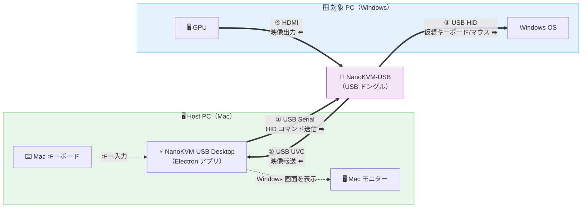

### 接続ケーブルと信号の流れ

| # | ケーブル | 方向 | 信号 | 説明 |
|---|---------|------|------|------|
| ① | USB (Mac → NanoKVM) | Host → NanoKVM | Serial Port | Mac から NanoKVM に HID キーボード/マウスコマンドを送信 |
| ② | USB (Mac ← NanoKVM) | NanoKVM → Host | USB UVC | NanoKVM が Windows の HDMI 映像を UVC カメラとして Mac に転送 |
| ③ | USB (NanoKVM → Windows) | NanoKVM → 対象PC | USB HID | NanoKVM が Windows に対して USB キーボード/マウスとしてデバイスを提示 |
| ④ | HDMI (Windows → NanoKVM) | 対象PC → NanoKVM | HDMI 映像 | Windows の GPU が出力した映像を NanoKVM が受け取り |

> **Note**: ① と ② は同一の USB ケーブル（Mac ↔ NanoKVM 間）で双方向に通信します。
> Mac からは NanoKVM がシリアルポートデバイスと UVC カメラの2つのデバイスとして認識されます。

### キーボード入力の経路

Mac のキーボードから Windows PC への入力は以下の経路で転送されます:

```
Mac キーボード
  │ keydown/keyup イベント
  ▼
Electron Renderer（React）
  │ event.code → HID Usage Code 変換
  │ 例: 'KeyA' → 0x04, 'ShiftLeft' → modifier bit 0x02
  ▼
8バイト HID レポート構築
  │ [modifiers, 0x00, key1, key2, key3, key4, key5, key6]
  │ 例: Shift+A → [0x02, 0x00, 0x04, 0x00, 0x00, 0x00, 0x00, 0x00]
  ▼
Electron Main Process（Serial Port）
  │ プロトコルパケット化 + CRC 付与
  ▼
USB Serial → NanoKVM-USB ハードウェア
  │ パケット解析 → USB HID デバイスとして出力
  ▼
Windows PC（USB HID 受信）
  │ 物理キーボードと同等の入力として処理
  ▼
Windows が 'A' を入力として認識
```

この経路は、ユーザーが Mac のキーボードを直接操作する場合も、AI エージェント（picoclaw）がプログラム的にキーを送信する場合も同一です。AI エージェントの場合は「Mac キーボード」の代わりに API Server が HID レポートを生成します。

### 画面表示の経路

Windows PC の画面が Mac に表示される経路は以下のとおりです:

```
Windows PC（GPU 映像出力）
  │ HDMI ケーブル
  ▼
NanoKVM-USB ハードウェア
  │ HDMI → USB UVC 変換（ハードウェアエンコード）
  │ Mac には USB カメラとして認識される
  ▼
Mac（USB UVC デバイス）
  │
  ├──→ Electron Renderer: getUserMedia() API
  │     <video> 要素に Windows 画面をリアルタイム表示（30fps）
  │     → Mac モニター上に Windows デスクトップが表示される
  │
  └──→ AI エージェント使用時: <canvas> で静止画キャプチャ
        → base64 JPEG → Vision LLM で画面状態を解析
        （ロック画面かデスクトップか等を判定）
```

> **Mac ロック中の映像キャプチャ**: macOS がロックされると Renderer プロセスがスロットリングされ、
> `getUserMedia()` が応答しなくなります。この場合、ffmpeg が AVFoundation 経由で
> 直接 UVC デバイスからキャプチャするフォールバックが動作します（後述の「ffmpeg キャプチャ実装アーキテクチャ」参照）。

---

## システム構成ブロック図

### 全体アーキテクチャ

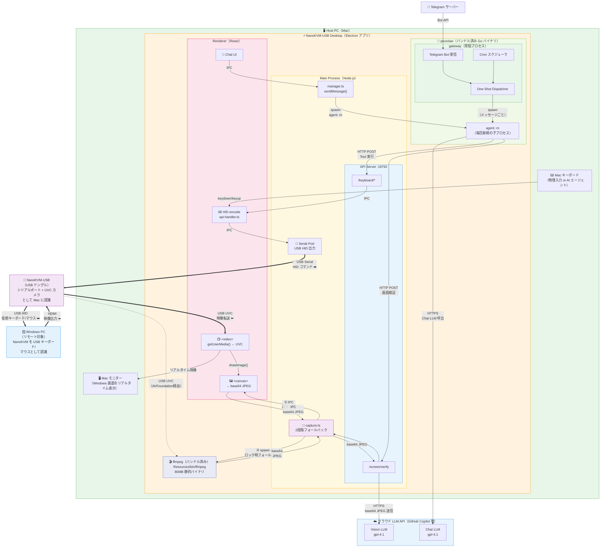

### Telegram ロック操作のシーケンス図

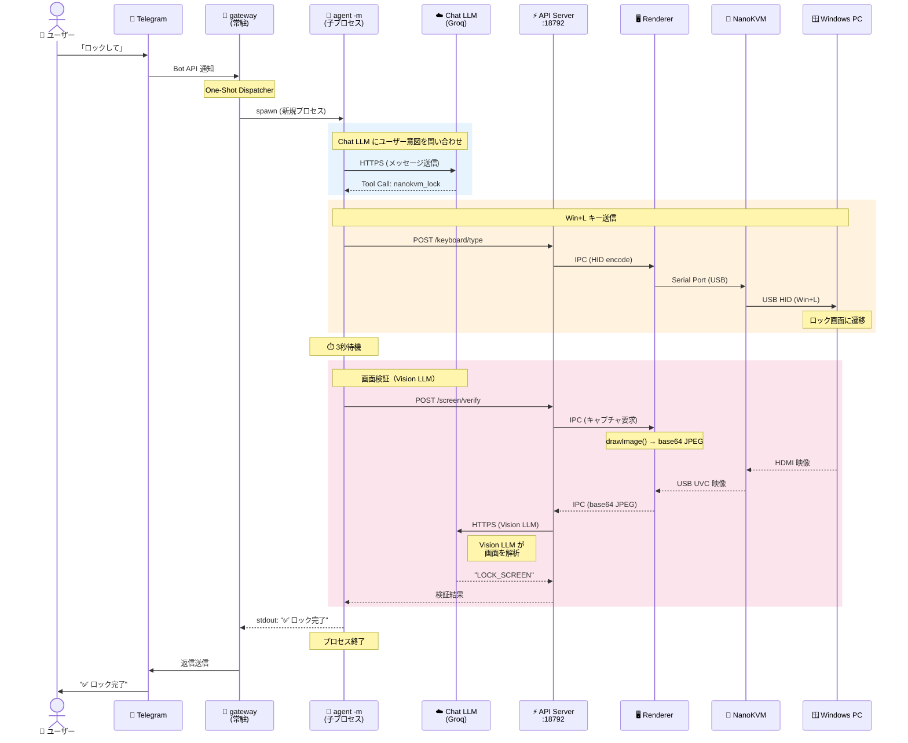

### ChatUI ロック操作のシーケンス図

> アプリ内蔵の ChatUI から同じロック操作を行う場合のシーケンスです。
> Telegram 経由とは異なり、gateway を介さず Renderer → Main Process 間の IPC で直接 picoclaw を呼び出します。

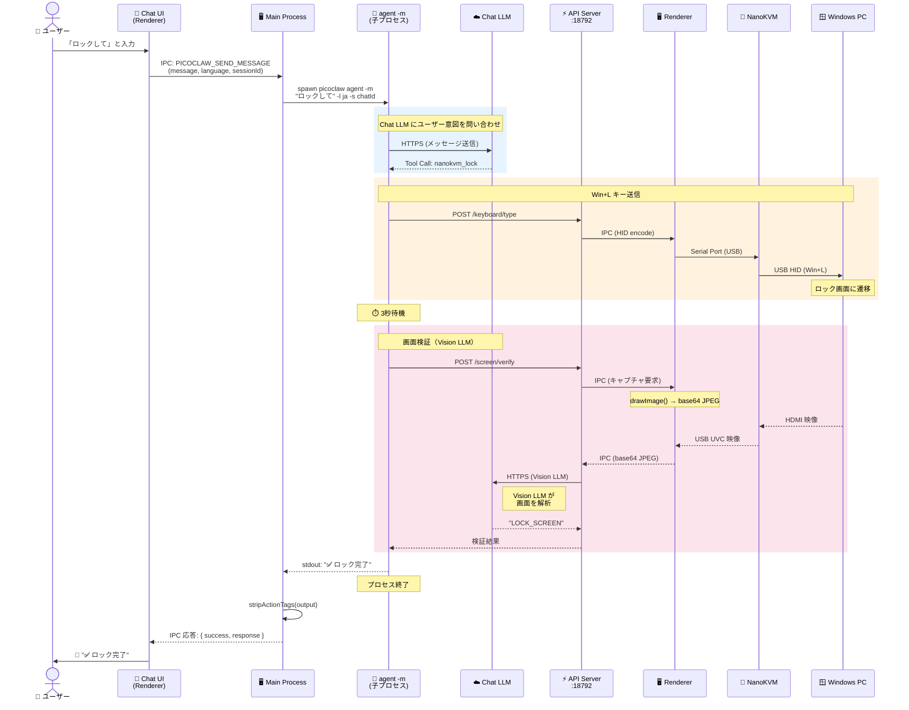

**Telegram と ChatUI の比較**:

| 項目 | Telegram | ChatUI |
|------|----------|--------|
| **入口** | Telegram Bot API → gateway (常駐) | Renderer IPC → Main Process |
| **プロセス管理** | gateway が spawn・監視 | manager.ts が spawn・監視 |
| **セッション** | Telegram Chat ID | `chat-{timestamp}` |
| **レスポンス** | Bot API で返信 | IPC で ChatUI に直接返却 |
| **言語設定** | picoclaw config | i18n.language を引数で渡す |
| **Tool Call 後処理** | gateway が interceptToolCallText | manager.ts が interceptToolCallText |
| **エラー表示** | Telegram メッセージ | ChatUI 赤バブル + レート制限ポップアップ |

**データフローの要点**:

| 方向 | フロー | 説明 |
|------|--------|------|
| **➡️ 操作** | Chat/Telegram → picoclaw agent -m → Chat LLM → Tool Call → API Server → Renderer → Serial Port → NanoKVM → Windows PC | キー・マウス操作の送信 |
| **⬅️ 映像** | Windows PC → HDMI → NanoKVM → USB (UVC) → Renderer `<video>` (getUserMedia) | HDMI 映像のリアルタイム表示 |
| **🔄 検証（通常）** | API Server → capture.ts → ① Renderer IPC canvas キャプチャ → base64 JPEG → Vision LLM → 判定結果 | 高速パス（~50ms） |
| **🔄 検証（ロック時）** | API Server → capture.ts → ② ffmpeg spawn → AVFoundation → base64 JPEG → Vision LLM → 判定結果 | フォールバック（~500ms） |

**バンドル済みコンポーネント（アプリ内蔵）**:

| コンポーネント | 配置パス | サイズ | 役割 |
|-------------|---------|-------|------|
| **picoclaw** | `resources/bin/picoclaw` | ~18MB | AI エージェント（Go 静的バイナリ） |
| **ffmpeg** | `Resources/bin/ffmpeg` | ~80MB | ロック時キャプチャ（ffmpeg-static） |
| **Electron/Chromium** | `Frameworks/` | ~254MB | アプリ基盤・Renderer・WebRTC |

---

## 対応コマンド

### 1. ロック（画面ロック）

| 項目 | 内容 |
|------|------|
| **操作内容** | Windows のショートカット `Win + L` を送信 |
| **対応フレーズ例** | 「Windowsをロックして」「PCをロックしてください」「ロック」「lock the screen」 |
| **内部動作** | `Win` キー押下 → `L` キー押下 → 100ms 保持 → 逆順にリリース |
| **事後検証** | 3秒後に画面キャプチャ → Vision LLM で LOCK_SCREEN を確認 |

### 2. ログイン（PIN / パスワード入力）

| 項目 | 内容 |
|------|------|
| **操作内容** | ロック画面を解除し、PIN コードまたはパスワードを入力してログイン |
| **対応フレーズ例** | 「PINコード mypin でログインして」「パスワードで入って」「login with PIN」 |
| **事後検証** | 15秒後に画面キャプチャ → Vision LLM で結果を判定 |

#### ログインシーケンス（PIN のみ）

| ステップ | 操作 | 目的 | 待機時間 |
|----------|------|------|----------|
| 0 | `Escape` キー押下 | 前回のPINエラーダイアログが残っている場合に閉じる | 200ms |
| 1 | `Space` キー押下 | ロック画面からサインイン画面を呼び起こす | 500ms |
| 1b | `Space` キー再押下 | バックアップの起動操作 | - |
| 2 | 待機 | Windows がPIN入力欄を描画・フォーカスするのを待つ | 1,500ms |
| 3 | `Backspace` × 10回 | 入力欄の既存文字をクリア（Ctrl+A はPIN欄で無効のため） | 各30ms間隔 |
| 4 | PIN を1文字ずつ入力 | HID キーボードレポートで各文字を送信 | 各80ms間隔 |
| 5 | `Enter` キー押下 | PIN を送信してログイン | - |

> **skipWake 最適化**: picoclaw 経由のログインでは、画面確認（screen_check）で既に PC が起動済みと確認されているため、S3 スリープ復帰シーケンス（5秒のマウス＋キーボードウェイク）をスキップします。これにより、ログイン所要時間が約14秒から約5秒に短縮されました。

#### ログインシーケンス（ユーザー名 + パスワード）

| ステップ | 操作 | 目的 | 待機時間 |
|----------|------|------|----------|
| 0 | `Escape` キー押下 | エラーダイアログを閉じる（前回失敗時の残り） | 300ms |
| 1〜3 | 上記と同じ | 画面起動・フィールドクリア | 同上 |
| 4 | ユーザー名を入力 | ユーザー名欄にテキスト入力 | 300ms |
| 5 | `Tab` キー押下 | パスワード欄に移動 | 300ms |
| 6 | パスワードを入力 | パスワード欄にテキスト入力 | 300ms |
| 7 | `Enter` キー押下 | ログイン実行 | - |

> **Note**: ユーザーが明示的に指定しない限り、ユーザー名は送信されません。LLM が OS 名やボット名をユーザー名として使用することを防ぐバリデーションが入っています。

---

## picoclaw ツール呼び出しの流れ

picoclaw は Go 側でネイティブなツール実行（function calling）を行います。
また、LLM がテキスト中にツール呼び出しを埋め込むケースに備え、
Electron 側のインターセプター（`manager.ts`）がフォールバック検出を行います。

### Go 側ネイティブツール（主要パス）

picoclaw agent はツール定義を LLM に渡し、構造化された function call で実行します:

| ツール名 | 説明 | パラメータ |
|----------|------|-----------|
| `nanokvm_lock` | Win+L でロック | なし |
| `nanokvm_login` | PIN/パスワード入力でログイン | `password`, `username?` |
| `nanokvm_shortcut` | キーボードショートカット送信 | `keys[]` |
| `nanokvm_type` | テキスト入力 | `text` |
| `nanokvm_mouse_click` | マウスクリック | `button` |

### Electron 側インターセプター（フォールバック）

LLM がテキスト出力にツール呼び出しを含めた場合の検出パターン（3形式対応）:

| 優先度 | フォーマット | 例 |
|--------|-------------|-----|
| 1 | アクションタグ | `<<nanokvm:login:mypin>>` |
| 2 | JSON オブジェクト | `{"type":"function","name":"nanokvm_login","parameters":{"password":"..."}}` |
| 3 | Python 関数呼び出し | `nanokvm_login(password='...')` |

### 重複実行防止

- 同一エンドポイント + 同一パラメータのリクエストは **15秒間の重複排除**（debounce）
- Go 側がネイティブ実行 → HTTP API 呼び出し → インターセプターも同じ API を呼ぼうとする → debounce で弾かれる

---

## レスポンスメッセージ

ユーザーに表示するメッセージは、LLM 出力からツール呼び出し構文を除去（`stripActionTags`）して生成されます。

### 除去対象

- `<<nanokvm:...>>` アクションタグ
- `nanokvm_` を含む JSON オブジェクト
- `nanokvm_xxx(...)` 関数呼び出し構文
- LLM プリアンブル文（例: "The function call that best answers the prompt is:"）

### フォールバック

除去後にテキストが空になった場合、「コマンドを実行しました」がデフォルトメッセージとして表示されます。

---

## 対応キー名

ショートカットで使用できるキー名はLLMの出力する一般的な名前から自動変換されます。

| 入力名 | 変換先（HID コード） |
|--------|---------------------|
| Win, Windows, Meta, Cmd | MetaLeft |
| Ctrl, Control | ControlLeft |
| Alt, Option | AltLeft |
| Shift | ShiftLeft |
| Del | Delete |
| Esc | Escape |
| Return | Enter |
| A〜Z（単一文字） | KeyA〜KeyZ |
| 0〜9（単一数字） | Digit0〜Digit9 |
| F1〜F24 | F1〜F24 |

---

## API エンドポイント一覧

HTTP API サーバー（`127.0.0.1:18792`）が提供するエンドポイント:

| メソッド | パス | パラメータ | 説明 |
|----------|------|-----------|------|
| POST | `/api/keyboard/shortcut` | `{"keys": ["Win", "L"]}` | キーボードショートカット送信 |
| POST | `/api/keyboard/login` | `{"password": "...", "username?": "user"}` | Windows ログイン実行 |
| POST | `/api/keyboard/type` | `{"text": "Hello"}` | テキスト入力 |
| POST | `/api/mouse/click` | `{"button": "left"}` | マウスクリック |
| GET | `/api/screen/capture` | なし | 現在の画面をキャプチャ（base64 JPEG） |
| POST | `/api/screen/verify` | `{"action": "lock"\|"login"\|"status"}` | 画面状態を Vision LLM で検証・確認 |

---

## 入力経路別の挙動

| 項目 | チャット UI | Telegram |
|------|------------|----------|
| **picoclaw 常駐プロセス** | なし（都度起動） | `picoclaw gateway`（常駐） |
| **メッセージ処理** | `manager.ts` → `spawn agent -m` | One-Shot Dispatcher → `spawn agent -m` |
| **LLM 呼び出し** | サブプロセス内 | サブプロセス内（同一） |
| **ツール実行** | Go 側ネイティブ | Go 側ネイティブ（同一） |
| **レスポンス表示** | チャット吹き出し | Telegram メッセージ |
| **セッション蓄積** | なし（毎回フレッシュ） | なし（毎回フレッシュ） |

---

## 制約事項

- **同時押しキー数**: HID 仕様により最大6キー（修飾キーは別枠）
- **文字入力**: ASCII 英数字・基本記号のみ対応（日本語入力は非対応）
- **マウス移動**: 座標指定は未実装（クリックのみ対応）
- **ログイン待機**: PIN 入力後 15 秒の固定待機（デスクトップ描画完了まで）
- **NanoKVM 操作回数**: 1メッセージあたり最大 4 回（不要な反復を防止）
- **ユーザー名バリデーション**: "windows", "linux", "ubuntu" 等の OS 名は自動除外

---

## セキュリティ: Credential Vault（認証情報保管庫）

### 課題: 現行方式のセキュリティリスク

現行のログイン操作では、ユーザーがチャットメッセージに PIN コードやパスワードを平文で記載します。
これにより以下のリスクが存在します:

| リスク | 現行の状態 | 影響 |
|--------|-----------|------|
| **チャット履歴への露出** | Telegram 履歴・Chat UI に PIN/パスワードが平文で残る | 第三者の覗き見、端末紛失時の漏洩 |
| **LLM プロバイダへの送信** | メッセージ全体が Chat LLM に送信される | クラウドサーバーに認証情報が到達 |
| **ログファイルへの記録** | インターセプター・API Server のログに記録される可能性 | ディスク上に平文で残存 |

> **現行の緩和策**: LLM がパスワードを `***` にマスクした場合は実行を拒否する「REDACTED 拒否」機能は存在しますが、
> これは LLM が自発的にマスクしたケースのみを防ぐもので、LLM への送信自体は防止できません。

### 解決策: Credential Vault

暗号化された認証情報保管庫（Credential Vault）を導入し、**Windows の PIN/パスワードがチャット経路を一切通らない**設計にします。

#### 設計原則

1. **Windows 認証情報は Vault 内にのみ保存** — チャットメッセージに記載しない
2. **マスターパスワードも LLM に送信しない** — Vault 解錠時は LLM をバイパス
3. **毎回マスターパスワードを要求** — セッション保持なし（One-Shot と一致）
4. **Telegram ではマスターパスワードメッセージを即時削除** — チャット履歴に残さない

#### ログイン操作フロー（Vault 有効時）

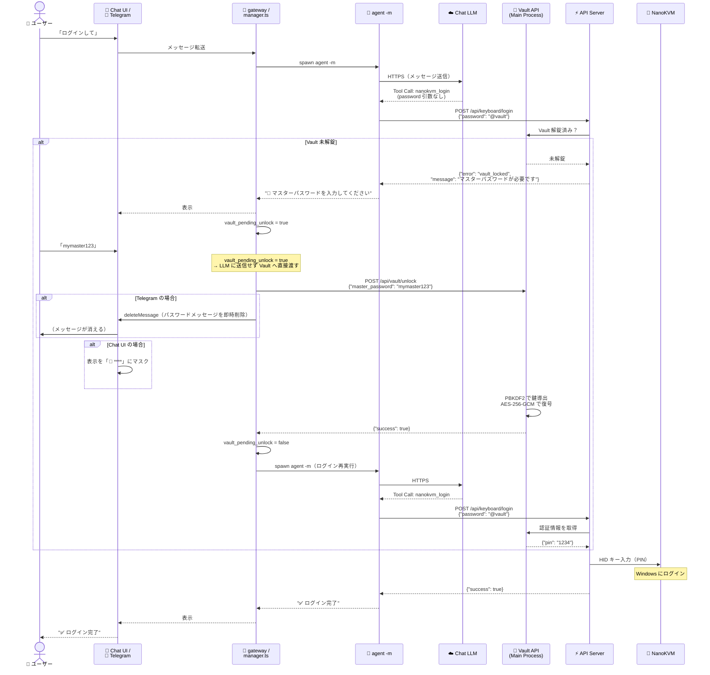

#### LLM バイパスの仕組み

マスターパスワードの入力時にLLMを経由させない仕組みは以下のとおりです。

| 段階 | メッセージ | LLM に送信 | チャット表示 | ログ記録 |
|------|-----------|:----------:|-------------|:--------:|
| ① ログイン要求 | 「ログインして」 | ✅ | そのまま表示 | ✅ |
| ② マスターPW要求 | (システム応答) | — | 「🔐 マスターパスワードを入力してください」 | — |
| ③ マスターPW入力 | 「mymaster123」 | ❌ 送信しない | Chat UI: 「🔐 ****」 / Telegram: 即時削除 | ❌ |
| ④ ログイン実行 | (自動) | ❌ | 「✅ ログイン完了」 | ✅（PINなし） |

**状態管理**: gateway（Telegram）/ manager.ts（Chat UI）に `vault_pending_unlock` フラグを追加。
このフラグが `true` の間は、次のユーザー入力を agent spawn せず、直接 Vault API に渡します。

#### Telegram メッセージ即時削除

Telegram Bot API の `deleteMessage` を使用して、マスターパスワードを含むメッセージを受信直後に削除します。

```
POST https://api.telegram.org/bot<token>/deleteMessage
{
  "chat_id": <chat_id>,
  "message_id": <password_message_id>
}
```

- 削除はサーバー側で行われるため、全端末のチャット履歴から消える
- 削除後、ボットから「🔐 認証を受け付けました」と返信
- 一瞬表示されるが、履歴には残らない

#### ストレージ設計

```
~/.picoclaw/vault.enc    ← AES-256-GCM 暗号化済みクレデンシャル
~/.picoclaw/vault.salt   ← PBKDF2 用ソルト（32バイト）
```

| 項目 | 方式 | 理由 |
|------|------|------|
| **暗号化** | AES-256-GCM | Node.js crypto 標準、認証付き暗号化（改竄検知付き） |
| **鍵導出** | PBKDF2-SHA256 (100,000 イテレーション) | マスターパスワードから 256bit 暗号化キーを導出 |
| **ソルト** | crypto.randomBytes(32) | 初回セットアップ時に生成、以後固定 |
| **マスターPW検証** | GCM 認証タグ | 復号失敗 = パスワード不一致（専用ハッシュ不要） |

保存データ構造（暗号化前の平文 JSON）:

```json
{
  "pin": "1234",
  "username": "",
  "description": "Windows PC"
}
```

> **Note**: プロファイルは1つのみ。複数 PC を操作する場合は Settings UI から切り替えます。

#### コンポーネント変更一覧

| コンポーネント | ファイル | 変更内容 |
|--------------|---------|---------|
| **Vault Manager** | `src/main/vault/manager.ts` (新規) | AES-256-GCM 暗号化ストレージ管理 |
| **IPC Events** | `src/common/ipc-events.ts` | `VAULT_SETUP`, `VAULT_UNLOCK`, `VAULT_SAVE`, `VAULT_STATUS` 追加 |
| **API Server** | `src/main/api/server.ts` | `POST /api/vault/unlock`, `GET /api/vault/credential` 追加 |
| **API Server (login)** | `src/main/api/server.ts` | `password: "@vault"` の場合に Vault から自動取得 |
| **Settings UI** | `src/renderer/src/components/menu/settings/picoclaw.tsx` | 「🔐 ログイン認証情報」セクション追加 |
| **manager.ts** | `src/main/picoclaw/manager.ts` | `vault_pending_unlock` 状態管理、LLM バイパス |
| **picoclaw (Go)** | gateway 側 | `vault_pending_unlock` 状態管理、`deleteMessage` 呼び出し |

#### Settings UI（設定画面）

```
┌─────────────────────────────────────────────┐
│ 🔐 ログイン認証情報                            │
│                                             │
│ ステータス: ✅ 設定済み                        │
│                                             │
│ ── 保存済みクレデンシャル ──                    │
│   認証方式: [PIN ▼]                           │
│   PIN:    [••••] [👁] [保存]                  │
│   説明:   Windows PC (自宅)                   │
│                                             │
│ ── マスターパスワード ──                       │
│   [現在のパスワード] [新しいパスワード] [変更]   │
│                                             │
│ ⚠️ マスターパスワードを忘れると保存済みの       │
│   認証情報を復元できません。                    │
└─────────────────────────────────────────────┘
```

#### セキュリティ比較

| 脅威 | 現行 | Vault 導入後 |
|------|:----:|:------------:|
| チャット履歴に Windows PIN が露出 | ❌ 丸見え | ✅ 一切表示されない |
| LLM プロバイダに PIN が送信される | ❌ 送信される | ✅ 送信されない |
| LLM プロバイダにマスター PW が送信される | — | ✅ 送信されない（LLM バイパス） |
| ログファイルに PIN が記録される | ❌ 記録される可能性 | ✅ `@vault` のみ記録 |
| Telegram 履歴にマスター PW が残る | — | ✅ 即時削除（deleteMessage） |
| NanoKVM アプリへの不正アクセス | ❌ PIN なしでログイン可能 | ✅ マスター PW が必要 |
| ディスク上の保存データ | — | ✅ AES-256-GCM で暗号化 |

#### 後方互換性

Vault 未設定時は従来どおり `「PIN xxxx でログインして」` でのログインも引き続き動作します。
Vault が設定されている場合のみ、PIN/パスワードなしの `「ログインして」` で Vault 経由のフローが有効になります。

| 状態 | 「ログインして」 | 「PIN 1234 でログインして」 |
|------|-----------------|---------------------------|
| Vault 未設定 | LLM が PIN を質問 | そのまま実行（従来動作） |
| Vault 設定済み・未解錠 | マスター PW を要求 | Vault を優先（メッセージ中の PIN は無視） |
| Vault 設定済み・解錠済み | Vault から PIN 取得して実行 | Vault を優先 |

---

## ffmpeg バンドルとクロスプラットフォーム対応

画面キャプチャ機能（macOS ロック中のフォールバック）で使用する ffmpeg は、`ffmpeg-static` npm パッケージを通じてアプリにバンドルされます。

### バンドル方式

| 項目 | 内容 |
|------|------|
| **パッケージ** | `ffmpeg-static` v5.3.0（静的リンク済みバイナリ） |
| **配置場所** | `electron-builder.yml` の `extraResources` で `<app>/Contents/Resources/bin/ffmpeg` にコピー |
| **バイナリサイズ** | 約 70〜80MB（プラットフォームにより異なる） |
| **検索優先順位** | ① バンドル済み → ② `/usr/local/bin/ffmpeg` → ③ `/opt/homebrew/bin/ffmpeg` → ④ `/usr/bin/ffmpeg` |

### プラットフォーム対応

| プラットフォーム | キャプチャ方式 | デバイス検出 | 状態 |
|----------------|-------------|------------|------|
| **macOS (Intel)** | AVFoundation | `[index] Device Name` | ✅ 動作確認済み |
| **macOS (Apple Silicon)** | AVFoundation | 同上 | ✅ 対応（ffmpeg-static が arm64 バイナリを提供） |
| **Windows** | DirectShow | `"Device Name"` | 🔧 実装済み（未テスト） |
| **Linux** | — | — | ❌ 未対応 |

### Windows 対応の実装詳細

Windows では ffmpeg の DirectShow 入力を使用して USB キャプチャカードから映像を取得します:

```
ffmpeg -f dshow -video_size 1920x1080 -i "video=USB3 Video" -frames:v 1 -f image2pipe -vcodec mjpeg -q:v 5 -
```

- デバイス検出: `ffmpeg -f dshow -list_devices true -i dummy` でデバイス名を取得
- 入力指定: `video=<デバイス名>` 形式（AVFoundation のインデックス指定とは異なる）
- バイナリ名: `ffmpeg.exe`（`ffmpeg-static` がビルドプラットフォームに応じて自動選択）

> **Note**: Windows では macOS ロック時のような Renderer スロットリング問題は通常発生しませんが、リモートデスクトップ切断時等に同様の状況が起こる可能性があるため、ffmpeg フォールバックを共通基盤として実装しています。

---

## ffmpeg キャプチャ実装アーキテクチャ

### 2段階フォールバック設計

画面キャプチャは **Renderer IPC（高速パス）** と **ffmpeg ネイティブキャプチャ（フォールバック）** の2段階で動作します。

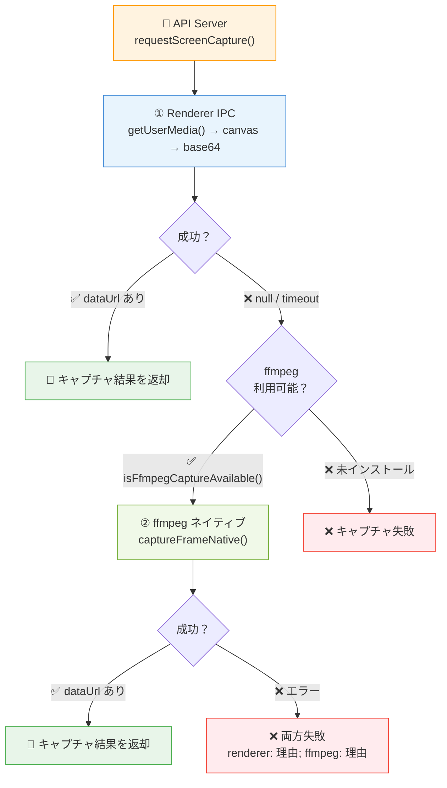

### 通常利用時（ロック解除状態）とロック時の動作

| 状態 | 映像表示 | キャプチャ方式 | ffmpeg の関与 |
|------|---------|-------------|-------------|
| **通常利用（ロック解除）** | `getUserMedia()` WebRTC | Renderer IPC（canvas → base64 JPEG） | **呼ばれない** |
| **macOS ロック中** | `getUserMedia()` はスロットリングで凍結 | Renderer IPC タイムアウト → ffmpeg フォールバック | **単一フレーム取得** |
| **リモートデスクトップ切断** | 同上の可能性 | 同上 | **単一フレーム取得** |

> **重要**: ffmpeg は**連続ストリーミングには使用しません**。`-frames:v 1` オプションにより1フレームだけ取得して即座にプロセス終了します。通常の映像表示（`<video>` タグ + WebRTC）には一切影響しません。

### 同時アクセスの安全性

| 懸念 | 実態 | 理由 |
|------|------|------|
| ffmpeg が映像品質を劣化させる？ | **影響なし** | 通常時は ffmpeg が呼ばれないため |
| ロック中に同時アクセスで問題？ | **影響なし** | macOS AVFoundation は複数プロセスからの同時読み取りを許容 |
| ffmpeg プロセスがリソースを占有？ | **極めて軽微** | 1フレーム < 1秒で完了、5秒のセーフティタイムアウトあり |
| Windows で getUserMedia と ffmpeg が競合？ | **可能性あり** | DirectShow は排他的ロックの場合あり。ただし「Resource busy」エラーで graceful に処理 |

### ffmpeg キャプチャパイプライン

`capture.ts` の実装詳細:

```
captureFrameNative(width, height, quality)
  │
  ├── findFfmpeg()                       … バンドル済み → システムパスの優先順位で検索
  │     └── getBundledFfmpegPath()       … Packaged: Resources/bin/ffmpeg, Dev: require('ffmpeg-static')
  │
  ├── detectCaptureDevice()              … プラットフォーム別のデバイス検出
  │     ├── [macOS]  detectCaptureDeviceMac()    … AVFoundation デバイス一覧 → インデックス返却
  │     └── [Windows] detectCaptureDeviceWin()   … DirectShow デバイス一覧 → デバイス名返却
  │
  ├── ffmpeg spawn                       … プラットフォーム別の引数でプロセス起動
  │     ├── [macOS]  -f avfoundation -framerate 30 -video_size WxH -i <index>
  │     └── [Windows] -f dshow -video_size WxH -i "video=<name>"
  │     └── 共通: -frames:v 1 -f image2pipe -vcodec mjpeg -q:v <quality> -
  │
  ├── stdout → Buffer[] → Buffer.concat  … JPEG バイナリを収集
  │
  ├── base64 変換 → data:image/jpeg;base64,...  … data URL 生成
  │
  └── 黒画面検出                          … JPEG < 2KB の場合に警告ログ（呼び出し元に判断委任）
```

### デバイス検出パターン

USB キャプチャカードの自動検出に使用するデバイス名パターン:

| パターン | 対象デバイス | 除外条件 |
|---------|------------|---------|
| `USB3 Video` | NanoKVM-USB 標準 | — |
| `USB2.0 HD UVC` | 汎用UVCキャプチャカード | — |
| `nanokvm` (大文字小文字不問) | NanoKVM ブランド全般 | — |
| `capture` (大文字小文字不問) | 汎用キャプチャデバイス | `screen` を含む場合は除外 |

### キャッシュ機構

| キャッシュ対象 | 変数名 | 初期値 | クリア条件 |
|-------------|--------|-------|-----------|
| ffmpeg バイナリパス | `cachedFfmpegPath` | `null` | アプリ再起動時のみ |
| AVFoundation デバイスインデックス | `cachedDeviceIndex` | `null` | `resetCaptureCache()` またはデバイス未検出エラー時 |
| DirectShow デバイス名 | `cachedDshowDeviceName` | `null` | `resetCaptureCache()` またはデバイス未検出エラー時 |

### エラーハンドリング

| エラー | 発生条件 | 対応 |
|--------|---------|------|
| `ffmpeg not available` | ffmpeg バイナリが見つからない | フォールバック不可、Renderer IPC のみに依存 |
| `no USB capture device detected` | USB キャプチャカード未接続 | `null` 返却、呼び出し元で NO_VIDEO 処理 |
| `capture device not found` | 検出済みデバイスが切断された | キャッシュクリア → 次回再検出 |
| `capture device busy` | 他プロセスが排他的に使用中 | `null` 返却（Windows DirectShow で発生可能性） |
| `ffmpeg capture timed out (5s)` | ffmpeg が5秒以内に完了しない | `SIGKILL` で強制終了 |
| `ffmpeg output too small` | 出力が100バイト未満 | 不正な出力として拒否 |

### 実装ファイル

| ファイル | 役割 |
|---------|------|
| `src/main/device/capture.ts` | ffmpeg ネイティブキャプチャの全実装（findFfmpeg, detectCaptureDevice, captureFrameNative, resetCaptureCache） |
| `src/main/api/server.ts` → `requestScreenCapture()` | 2段階フォールバック制御（Renderer IPC → ffmpeg） |
| `src/main/api/server.ts` → `requestScreenCaptureViaIpc()` | Renderer IPC キャプチャ（5秒タイムアウト） |
| `src/renderer/src/libs/media/camera.ts` | Renderer 側 getUserMedia() → `<video>` → `<canvas>` → base64 |

---

## 画面状態確認機能（Screen Check）

「画面状態を確認して」などの指示で、リモート PC の現在の画面をキャプチャし、Vision LLM で分析して結果を返却します。

### 対応キーワード

- 「画面状態を確認して」
- 「今何が映ってる？」
- 「画面を見て」
- 「スクリーンショット」
- "screen check"

### 動作フロー

1. picoclaw エージェントが `nanokvm_screen_check` ツールを呼び出し
2. Go 側が `POST /api/screen/verify` に `{"action": "status"}` を送信
3. Electron API Server が HDMI キャプチャを実行
4. **黒画面（brightness < 15）の場合**: マウス左クリック＋キーボード Space キーを HID 送信してスリープ復帰を試行 → 4秒待機 → 再キャプチャ（最大2回リトライ）
   > **閾値 15 の根拠**: HDMI キャプチャカードはソースディスプレイ OFF 時でも brightness 3〜12 のノイズフレームを生成する。閾値 8 ではこれらが Vision LLM に渡り「真っ黒」→ NO_SIGNAL（誤分類）となっていた。閾値 15 に引き上げることで、スリープ時のノイズフレームをウェイクアップパスに正しくルーティング
5. 映像取得成功なら Vision LLM に汎用プロンプトで画面内容を記述させる
6. ステータス分類（`DESKTOP` / `LOCK_SCREEN` / `LOGIN_SCREEN` / `DESCRIBED`）と詳細説明を返却
7. リトライ後も黒画面の場合は `BLACK_SCREEN` ステータスを返却（「マウスクリックとキーボード入力でスリープ復帰を試みましたが画面が変わりませんでした」）
8. 早期終了で即座にユーザーに結果を表示

> **ウェイク操作の設計**: マウス左クリック（press+release）とキーボード Space キー（press+release）の両入力を送信。S3 スリープからの復帰はキーボード入力のみに応答する PC もあるため、両方を併用。4秒の待機時間は S3 レジューム + HDMI 信号安定に必要な時間を考慮。最大2回までリトライ。

### レスポンス例

| ステータス | アイコン | 例 |
|------------|--------|-----|
| `DESKTOP` | 🖥️ | デスクトップ画面です。複数のアプリケーションウィンドウが見えます。 |
| `LOCK_SCREEN` | 🔒 | ロック画面です。時計とユーザーアバターが表示されています。 |
| `LOGIN_SCREEN` | 🔑 | サインイン画面です。PIN 入力フィールドが表示されています。 |
| `DESCRIBED` | 🔍 | 画面状態: （Vision LLM の記述） |
| `NO_VIDEO` | 📹 | 映像がありません。PCが接続されていてストリーミングが開始されていることを確認してください。 |
| `BLACK_SCREEN` | 🖥️ | 画面が真っ黒です。マウスクリックとキーボード入力でスリープ復帰を試みましたが画面が変わりませんでした。PCの電源が入っていることを確認してください。 |
| `NO_SIGNAL` | 📡 | 信号がありません。黒い画面またはブランク画面が検出されました。 |

### エラーハンドリング

| 状況 | 原因 | Go側の判定 | ユーザーへのメッセージ |
|------|------|-----------|---------------------|
| **映像なし（screen_check）** | PC 未接続 / ストリーミング未開始 | `success=false`, `status="NO_VIDEO"` | 📹 映像がありません。PCがNanoKVM-USBに接続されていて… |
| **映像なし（lock）** | 同上 | `v.Status == "NO_VIDEO"` | ⚠️ Win+Lを送信しましたが、映像がないため結果を確認できません… |
| **映像なし（login）** | 同上 | `v.Status == "NO_VIDEO"` | ⚠️ ログイン操作を送信しましたが、映像がないため結果を確認できません… |
| **黒画面（screen_check）** | PC スリープ / HDMI 信号未安定 | `success=false`, `status="BLACK_SCREEN"` | 🖥️ 画面が真っ黒です。マウスクリック+キーボード入力で復帰試行済み… |
| **黒画面（lock）** | 同上 | `v.Status == "BLACK_SCREEN"` | ⚠️ Win+Lを送信しましたが、画面が真っ黒です。PCがスリープ中か… |
| **黒画面（login）** | 同上 | `v.Status == "BLACK_SCREEN"` | ⚠️ ログイン操作を送信しましたが、画面が真っ黒です… |
| **アプリ未起動** | API Server に接続不可 | `result == nil` | NanoKVM-USB デスクトップアプリに接続できませんでした… |
| **Vision 未設定** | Vision LLM プロバイダ/モデル未設定 | `visionConfigured=false` | Vision LLM が設定されていません… |
| **セッション履歴破損** | 並列 tool_calls のレスポンス欠落 | `sanitizeToolCallHistory()` で自動トランケート | （自動修復：ログに WARNING 出力、ユーザーへのメッセージなし） |
| **並列 tool レスポンス欠落** | `sanitizeHistoryForProvider()` が連続 tool メッセージを削除 | predecessor チェックを `role=="tool"` にも拡張 | （透過的修正：ユーザー影響なし） |
---

## チャット用 LLM（Chat LLM）

picoclaw のチャット機能（自然言語によるコマンド解釈・応答生成）に使用する LLM プロバイダとモデルの一覧です。
自動更新機能によりモデルリストは定期的に更新されますが、以下が現在のデフォルト構成です。

### チャット LLM プロバイダ・モデル一覧

| プロバイダ | デフォルトモデル | 認証方式 | 料金 | 備考 |
|-----------|-----------------|---------|------|------|
| **Groq** | llama-3.3-70b-versatile | API Key | **無料枠あり** | 推奨: 高速・クレカ不要 |
| **OpenAI** | gpt-5.2 | API Key | 有料 | 高品質・安定 |
| **Anthropic** | claude-sonnet-4.6 | API Key | 有料 | 高品質 |
| **DeepSeek** | deepseek-chat | API Key | 安価 | コスト効率 |
| **Google Gemini** | gemini-2.0-flash-exp | API Key | 無料枠あり | 高速 |
| **GitHub Copilot** | **gpt-4.1** | OAuth (gh CLI) | **無料** | `gh auth login` で認証・**推奨** |
| **OpenRouter** | auto | API Key | 従量制 | 多プロバイダ統合 |
| **Mistral AI** | mistral-small-latest | API Key | 有料 | 欧州拠点 |
| **Ollama** | llama3 | 不要 | **無料** | ローカル実行 |
| **VLLM** | custom-model | 不要 | **無料** | ローカル実行 |
| **NVIDIA** | nemotron-4-340b-instruct | API Key | 要確認 | GPU 推論 |
| **Cerebras** | llama-3.3-70b | API Key | 要確認 | 高速推論 |
| **Qwen** | qwen-plus | API Key | 安価 | 中国拠点 |
| **Zhipu AI** | glm-4.7 | API Key | 安価 | 中国拠点 |
| **Moonshot** | moonshot-v1-8k | API Key | 安価 | 中国拠点 |
| **Volcengine** | doubao-pro-32k | API Key | 安価 | ByteDance |
| **ShengsuanYun** | deepseek-v3 | API Key | 安価 | 中国拠点 |

### GitHub Copilot / GitHub Models 対応モデル

GitHub Copilot プロバイダは [GitHub Models API](https://models.inference.ai.azure.com) を使用します。
`gh auth login` で取得した OAuth トークン (`gho_*`) で認証し、API キーの手動入力は不要です。

#### 初回認証フロー

GitHub Copilot を使用するには GitHub CLI (`gh`) のインストールと認証が必要です。
アプリ内の「🔑 GitHub 認証を開始」ボタンから以下のフローで認証できます:

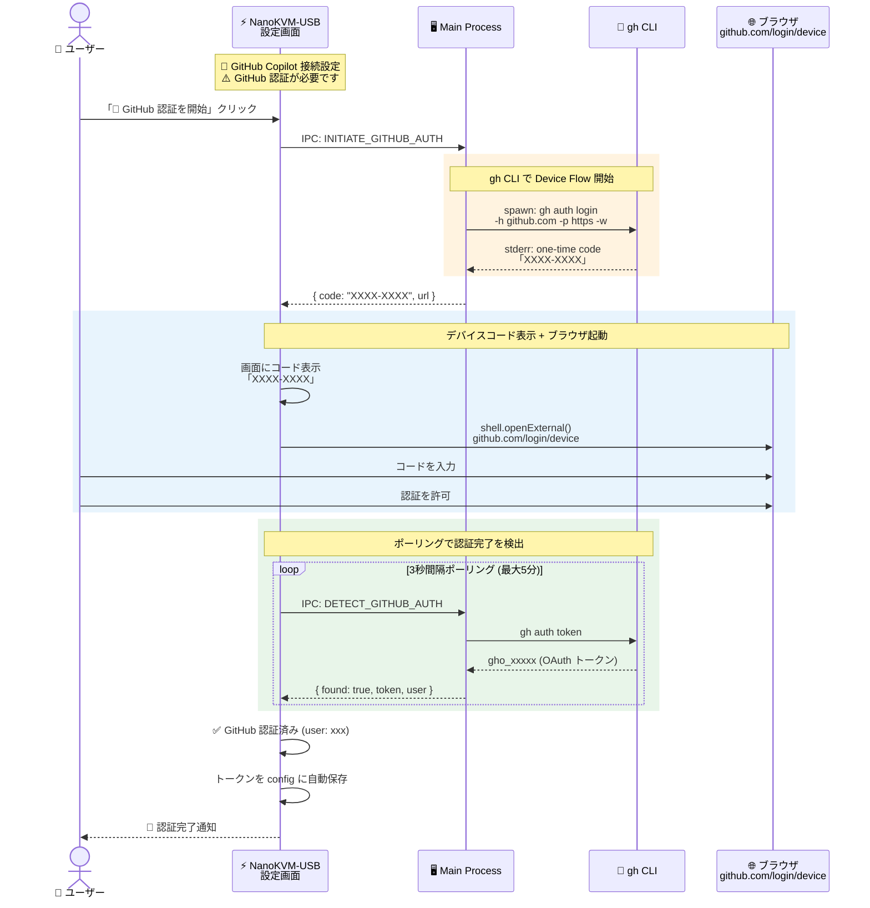

**前提条件**:
- [GitHub CLI (`gh`)](https://cli.github.com) がインストール済み
- GitHub アカウントを持っている（無料アカウントでOK）
- GitHub Copilot の登録は**不要**（GitHub Models API は全ユーザーに無料提供）

**実装ファイル**:
| ファイル | 役割 |
|---------|------|
| `manager.ts` → `initiateGitHubAuth()` | `gh auth login --web` を spawn、デバイスコード取得 |
| `manager.ts` → `detectGitHubToken()` | `gh auth token` でトークン検出 |
| `manager.ts` → `cancelGitHubAuth()` | 認証プロセスを kill |
| `picoclaw.ts` (events) | IPC ハンドラ (`INITIATE_GITHUB_AUTH`, `CANCEL_GITHUB_AUTH`) |
| `picoclaw.tsx` (renderer) | UI: デバイスコード表示、ポーリング、完了通知 |

| モデル名 | 種別 | Vision | 備考 |
|---------|------|--------|------|
| **gpt-4o-mini** | Chat | ✅ | 高速・軽量 |
| **gpt-4o** | Chat | ✅ | 高品質 |
| **gpt-4.1** | Chat | ✅ | **推奨**: 最新世代・高品質 |
| **gpt-4.1-mini** | Chat | ✅ | 最新世代・軽量 |
| **gpt-4.1-nano** | Chat | - | 超軽量 |
| **o1** | Reasoning | - | 推論特化 |
| **o3** | Reasoning | - | 推論特化 |
| **o3-mini** | Reasoning | - | 推論特化・軽量 |
| **o4-mini** | Reasoning | - | 最新推論モデル |
| **Meta-Llama-3.1-405B-Instruct** | Chat | - | 大型オープン |
| **Meta-Llama-3.1-8B-Instruct** | Chat | - | 軽量オープン |
| **Llama-3.2-11B-Vision-Instruct** | Chat | ✅ | **Vision対応**: 画面検証に使用可能 |
| **Llama-3.2-90B-Vision-Instruct** | Chat | ✅ | **Vision対応**: 高精度 |
| **Phi-4** | Chat | - | Microsoft 軽量 |
| **Phi-4-multimodal-instruct** | Chat | ✅ | **Vision対応**: Microsoft |
| **DeepSeek-R1** | Reasoning | - | 推論特化 |
| **MAI-DS-R1** | Reasoning | - | Microsoft + DeepSeek |
| **Mistral-large-2407** | Chat | - | Mistral 大型 |

> **Note**: GitHub Copilot の Web/VS Code 版では Claude 等の Anthropic モデルも選択可能ですが、
> GitHub Models API (`models.inference.ai.azure.com`) ではサポートされていません。
> picoclaw は GitHub Models API を経由するため、上記のモデルのみ利用可能です。

---

## モデルリスト自動更新機能

picoclaw のモデルリストは、プロバイダが新モデルを追加した際に自動更新されます。
v2026.03.02 より **3ソースマージアーキテクチャ** と **Vision LLM 動的ドロップダウン** が導入されました。

### 概要

- **更新対象**: 各プロバイダが提供するモデルの一覧（`~/.picoclaw/config.json` の `cached_models`）
- **更新元**: 3ソースからのマージ（後述）
- **表示**: 設定画面の Chat LLM・Vision LLM 両方のモデル選択ドロップダウンに動的反映

### 3ソースマージアーキテクチャ

モデルドロップダウンに表示されるモデルは、以下の3つのソースをマージして生成されます:

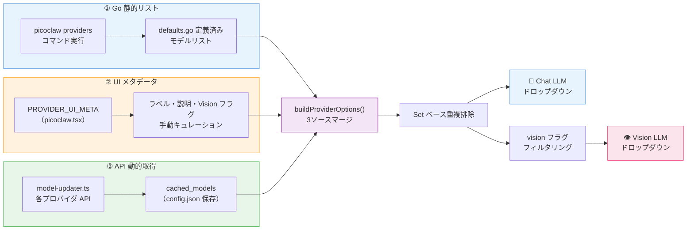

| ソース | データ元 | 更新タイミング | 内容 |
|--------|---------|-------------|------|
| ① Go 静的リスト | `picoclaw providers` CLI | picoclaw バイナリ更新時 | デフォルトモデル名のみ（ラベルなし） |
| ② UI メタデータ | `PROVIDER_UI_META` (TypeScript) | アプリ更新時 | ラベル・説明文・Vision フラグ・emoji |
| ③ API 動的取得 | 各プロバイダ REST API | スケジュール or 手動更新 | 最新のモデル一覧（ID のみ） |

#### マージロジック

```
1. Go 静的リスト のモデルを起点にする
   └─ Go は provider-prefixed な ID を返す (例: "groq/meta-llama/llama-4-scout-...")
   └─ addedIds Set に prefixed ID と stripProtocolPrefix() で取得した bare ID の両方を登録
2. 各モデルに UI メタデータ があれば、ラベル・説明・Vision フラグを付与
   └─ PROVIDER_UI_META の lookup は bare ID で行う (meta-llama/... 等の HuggingFace 形式に対応)
3. UI メタデータ にあるが Go リストにないモデルを追加（手動キュレーション分）
   └─ value は ensureProtocolPrefix(modelId, provider) で正規化した prefixed ID を使用
   └─ addedIds に bare ID と prefixed ID の両方を登録（重複防止）
4. cached_models にあるが 1-3 にないモデルを追加（API 検出分）
   └─ value は ensureProtocolPrefix(modelId, provider) で正規化
   └─ UI メタデータにない場合: isLikelyVisionModel() で Vision フラグを自動判定
      └─ Vision 判定された場合: モデル名に 👁️ を自動付与
5. Set ベースの重複排除（prefixed ID と bare ID の dual-key で同一モデルの重複を排除）
```

> **known-protocols**: `src/common/known-protocols.ts` に定義された `KNOWN_PROTOCOLS` Set（28プロトコル）と
> `ensureProtocolPrefix()` / `stripProtocolPrefix()` / `hasKnownProtocolPrefix()` ヘルパー関数を使用。
> Go 側 `pkg/config/migration.go` の `knownProtocols` マップと同期を保つ必要がある。

#### Vision モデル自動検出ヒューリスティック

API 経由で発見された新モデルに Vision 対応フラグを自動付与するための正規表現パターン:

```typescript
const VISION_MODEL_PATTERNS = /vision|llava|moondream|gpt-4o|gpt-4\.1|scout|maverick|multimodal|gemini|claude-3/i
```

このパターンにマッチするモデルは、UI メタデータに明示的な定義がなくても Vision 対応として扱われ、
Vision LLM ドロップダウンに自動的に表示されます。

### Vision LLM 動的ドロップダウン

v2026.03.02 より、Vision LLM のプロバイダ・モデル選択は **ハードコードされた静的リストではなく、
Chat LLM と同じ動的 `providers` ステートから Vision フラグでフィルタリング** して表示されます。

| 項目 | 旧方式（〜v2026.02.27） | 新方式（v2026.03.02〜） |
|------|------------------------|------------------------|
| **プロバイダ一覧** | `VISION_PROVIDERS` 静的配列 | `providers` ステートを `model.vision` でフィルタ |
| **モデル一覧** | 手動定義のみ | 3ソースマージ + Vision 自動検出 |
| **新モデル追加** | コード変更が必要 | API 更新で自動反映 |
| **設定画面の保存** | 更新前に保存が必要 | 保存不要（API キー設定済みなら即更新可能） |

### モデル更新プロバイダ対応

「今すぐ更新」ボタンまたはスケジュール実行時に、以下の全プロバイダの API からモデルリストを自動取得します:

| プロバイダ | API エンドポイント | 認証方式 |
|-----------|-------------------|---------|
| **Groq** | `https://api.groq.com/openai/v1/models` | Bearer API Key |
| **OpenAI** | `https://api.openai.com/v1/models` | Bearer API Key |
| **OpenRouter** | `https://openrouter.ai/api/v1/models` | 認証不要 |
| **Anthropic** | `https://api.anthropic.com/v1/models` | `x-api-key` ヘッダー |
| **DeepSeek** | `https://api.deepseek.com/models` | Bearer API Key |
| **Ollama** | `http://localhost:11434/api/tags` | 認証不要 |
| **Mistral** | `https://api.mistral.ai/v1/models` | Bearer API Key |

> **v2026.03.02 変更**: 以前は現在設定中の Chat/Vision プロバイダのみ更新していましたが、
> **API キーが設定済みのすべてのプロバイダを常にチェック** するよう変更しました。
> これにより、プロバイダを変更する前にモデルリストを事前に取得できます。

### 自動フォールバック

モデル更新後、現在設定中のモデルが新しいリストに存在しない場合、
プロバイダごとの推奨フォールバックモデルに自動切替します:

| プロバイダ | 推奨フォールバック | Vision フォールバック |
|-----------|-------------------|---------------------|
| **Groq** | llama-3.1-8b-instant, llama-3.3-70b-versatile | llama-4-scout, llama-4-maverick, llama-3.2-11b-vision |
| **OpenAI** | gpt-4o-mini, gpt-4o | gpt-4o-mini, gpt-4o |
| **OpenRouter** | llama-3.1-8b-instruct, gemini-2.0-flash | gemini-2.0-flash, claude-3.5-sonnet |
| **Anthropic** | claude-3-5-haiku, claude-3-5-sonnet | claude-3-5-haiku, claude-3-5-sonnet |
| **DeepSeek** | deepseek-chat, deepseek-coder | — |
| **Ollama** | llama3.2:1b, llama3.2:latest | moondream2:latest, llava:latest |
| **Mistral** | mistral-small-latest, mistral-large-latest | — |

### スケジュール設定

| 項目 | オプション | デフォルト |
|------|----------|----------|
| **頻度** | 日次 / 週次 / 月次 | **月次** |
| **実行時刻** | 0:00 〜 23:00 | **0:00** |
| **曜日**（週次） | 月〜日 | 月曜日 |
| **日付**（月次） | 1〜28日 | 1日 |
| **有効/無効** | トグル | **有効** |

### 更新フロー

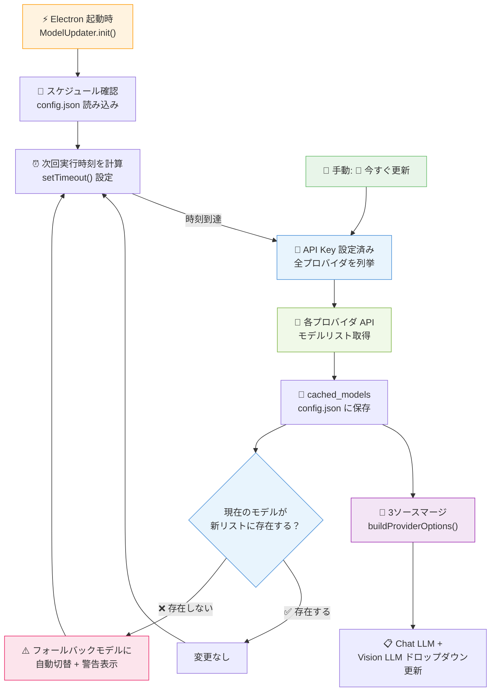

### 手動更新

設定画面の「🔄 今すぐ更新」ボタンで即時実行できます。
更新完了後、`onModelsUpdated` コールバックにより `loadProviders()` が再実行され、
Chat LLM・Vision LLM 両方のドロップダウンが即座にリフレッシュされます。

### Config 構造（自動更新関連）

```json
{
  "model_update": {
    "enabled": true,
    "frequency": "monthly",
    "hour": 0,
    "dayOfMonth": 1,
    "cached_models": {
      "groq": ["llama-3.3-70b-versatile", "llama-3.1-8b-instant", "llama-4-scout-17b-16e-instruct", "..."],
      "openai": ["gpt-4o-mini", "gpt-4o", "gpt-4-turbo", "o1", "o3", "..."],
      "openrouter": ["google/gemini-2.0-flash-001", "anthropic/claude-3.5-sonnet", "..."]
    }
  }
}
```

> **cached_models フィールド**: v2026.03.02 で追加。`updateNow()` 実行後にプロバイダごとのモデル ID 配列が保存され、
> 次回の UI 表示時に `buildProviderOptions()` で3ソースマージに使用されます。

ステータスは `~/.picoclaw/model-update-status.json` に保存:

```json
{
  "lastChecked": "2026-02-25T00:00:00Z",
  "nextCheck": "2026-03-01T00:00:00Z",
  "lastUpdatedModels": ["groq: 4 models", "openai: 1 model"],
  "autoSwitched": false
}
```

---

## 画面検証機能（Vision LLM）

ロック・ログインコマンド実行後、NanoKVM-USB の HDMI キャプチャ映像をスクリーンキャプチャし、**専用の Vision LLM** で画面内容を解析して結果を自動判定します。

### 設計思想: チャット用 LLM と Vision LLM の分離

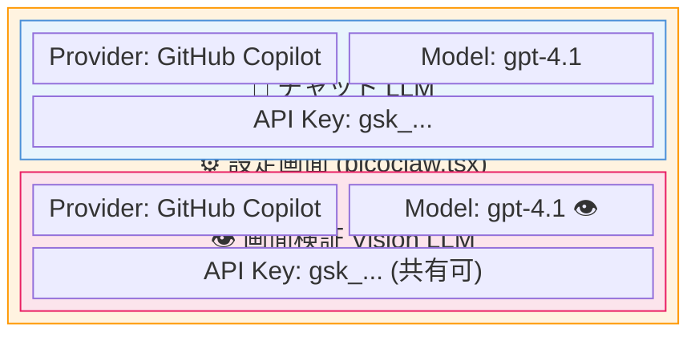

**理由**: チャットには安価なテキスト LLM、画面検証には Vision 対応 LLM という使い分け。
例: チャット = gpt-4.1 (GitHub Copilot 無料) + Vision = gpt-4.1 (GitHub Copilot 無料)

> **推奨構成**: GitHub Copilot の `gpt-4.1` を Chat・Vision 両方に設定。無料で高品質かつプロンプト調整が最小限で済みます。

> **動的ドロップダウン（v2026.03.02〜）**: Vision LLM のプロバイダ・モデル選択は、Chat LLM と同一の
> 動的 `providers` ステート（3ソースマージ）から Vision 対応モデルのみをフィルタリングして表示されます。
> 新しい Vision 対応モデルが API 経由で発見された場合も、自動更新後にドロップダウンに即反映されます。

### 検証フロー

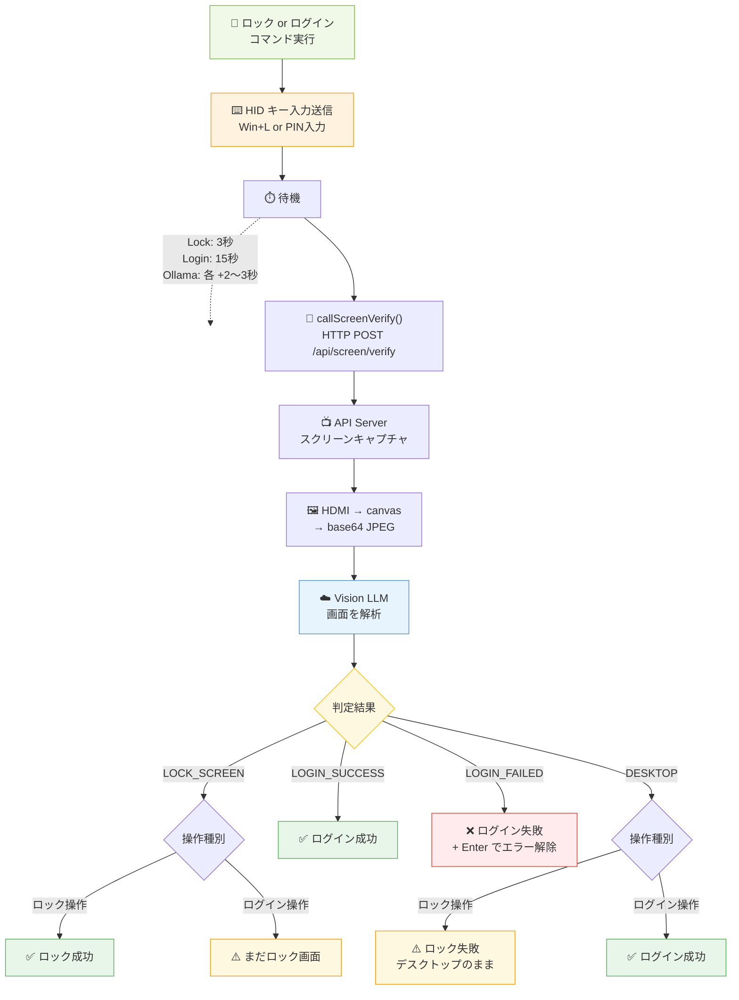

### Vision プロンプト

Vision LLM には画面内容に応じた専用プロンプトを使用:

- **ロック検証**: "Is this a Windows lock screen or a desktop?" → `LOCK_SCREEN` / `DESKTOP`
- **ログイン検証**: "What is the Windows login status?" → `LOGIN_SUCCESS` / `LOGIN_FAILED` / `LOCK_SCREEN`
  - タスクバーの有無を重視（タスクバーが見える = デスクトップ = LOGIN_SUCCESS）

> **多言語レスポンス対応**: Vision LLM のプロンプトには、picoclaw 設定の `language` フィールドに応じた言語指示が自動付加されます。例: `language: "ja"` の場合「日本語で回答してください」が追加され、画面状態の説明が日本語で返されます。対応言語: ja, zh, ko, de ほか。

### NanoKVM 操作の早期終了条件

Vision 検証の結果が以下のいずれかを含むとき、picoclaw は追加の LLM 呼び出しを行わず即座にユーザーに結果を返します:

| 結果 | 条件 | 動作 |
|------|------|------|
| ✅ 成功 | 応答に ✅ を含む | 早期終了・成功として返却 |
| ❌ 失敗 | 応答に ❌ / LOGIN_FAILED を含む | 早期終了・失敗として返却 |
| ⚠️ 未完了 | 応答に ⚠️ / LOCK_SCREEN を含む | 早期終了・警告として返却 |

これにより、不要な反復 LLM 呼び出し（→ 429 エラー）を防止します。

### Vision LLM 未設定時の振る舞い

Vision LLM が設定されていない場合:
- **事後検証**: Go 側で `callScreenVerify()` が呼ばれるが、API Server が「未設定」を返却
- ツール結果は「✅ 操作完了」で返される（検証なし）
- 初回操作時に設定案内メッセージが表示される

### Vision LLM 対応モデル一覧

> **Note（v2026.03.02〜）**: 以下のテーブルは参考情報です。実際の UI ドロップダウンは3ソースマージによる動的リストで表示され、
> プロバイダ API の自動更新により新モデルが追加された場合も自動的に反映されます。
> Vision 判定は `VISION_MODEL_PATTERNS` 正規表現 + `PROVIDER_UI_META` の `vision` フラグで決定されます。

| プロバイダ | モデル | 料金 | 速度 | 備考 |
|-----------|--------|------|------|------|
| **Groq** | **meta-llama/llama-4-scout-17b-16e-instruct** | **無料** | 高速 (~500ms) | **推奨**: Llama 4 Scout・クレカ不要 |
| **Groq** | meta-llama/llama-4-maverick-17b-128e-instruct | **無料** | 高速 | Llama 4 Maverick・高精度 |
| **Groq** | llama-3.2-11b-vision-preview | **無料** | 高速 | Llama 3.2 11B Vision |
| **Groq** | llama-3.2-90b-vision-preview | **無料** | 低速 | Llama 3.2 90B Vision・高精度 |
| **GitHub Copilot** | **gpt-4.1** | **無料** | 高速 | **推奨**: gh 認証のみ・最新世代 |
| **GitHub Copilot** | gpt-4o | **無料** | 高速 | 高品質 |
| **GitHub Copilot** | gpt-4.1-mini | **無料** | 高速 | 最新世代・軽量 |
| **GitHub Copilot** | Llama-3.2-11B-Vision-Instruct | **無料** | 中速 | オープンモデル |
| **GitHub Copilot** | Llama-3.2-90B-Vision-Instruct | **無料** | 低速 | 高精度 |
| **GitHub Copilot** | Phi-4-multimodal-instruct | **無料** | 中速 | Microsoft モデル |
| **Ollama** | moondream2:latest | **無料** | ~60秒 | 1.7B・ローカル・CPU向き |
| **Ollama** | moondream:latest | **無料** | ~60秒 | Moondream v1 |
| **Ollama** | llava:latest | **無料** | ~3分 | LLaVA 7B・高精度 |
| **Ollama** | llava:7b | **無料** | ~3分 | LLaVA 7B 明示指定 |
| **Ollama** | llava:13b | **無料** | ~5分 | LLaVA 13B・高精度・要GPU |
| **Ollama** | llava-llama3:latest | **無料** | ~3分 | LLaVA-Llama3・新世代 |
| **Ollama** | bakllava:latest | **無料** | ~3分 | BakLLaVA・Mistral ベース |
| **OpenRouter** | google/gemini-2.0-flash-001 | 安価 | 高速 | Gemini 2.0 Flash |
| **OpenRouter** | google/gemini-pro-1.5 | 安価 | 中速 | Gemini Pro 1.5 |
| **OpenRouter** | anthropic/claude-3.5-sonnet | 高額 | 中速 | Claude 3.5 Sonnet |
| **OpenRouter** | anthropic/claude-3-5-sonnet | 高額 | 中速 | Claude 3.5 Sonnet (旧ID) |
| **OpenRouter** | anthropic/claude-3-haiku | 安価 | 高速 | Claude 3 Haiku |
| **OpenRouter** | openai/gpt-4o | 高額 | 中速 | GPT-4o (OpenRouter 経由) |
| **OpenRouter** | openai/gpt-4o-mini | 安価 | 高速 | GPT-4o Mini (OpenRouter 経由) |
| **OpenAI** | gpt-4o-mini | 安価 | 高速 | 推奨・低コスト |
| **OpenAI** | gpt-4o | 高額 | 中速 | 高精度 |
| **OpenAI** | gpt-4-turbo | 高額 | 低速 | GPT-4 Turbo |
| **Anthropic** | claude-3-5-haiku-20241022 | 安価 | 高速 | コスト効率 |
| **Anthropic** | claude-3-5-sonnet-20241022 | 高額 | 中速 | 高精度 |
| **Anthropic** | claude-3-opus-20240229 | 最高額 | 低速 | 最高精度 |
| **Anthropic** | claude-3-sonnet-20240229 | 高額 | 中速 | バランス |
| **Anthropic** | claude-3-haiku-20240307 | 安価 | 高速 | 旧世代・高速 |

### タイムアウト設定

| プロバイダ | 検証遅延 (ロック) | 検証遅延 (ログイン) | API タイムアウト |
|-----------|------------------|-------------------|----------------|
| クラウド (Groq等) | 3秒 | 15秒 | 30秒 |
| Ollama (ローカル) | 5秒 | 15秒 | 120秒 |

### Config 構造

```json
{
  "agents": {
    "defaults": {
      "provider": "github-copilot",
      "model_name": "github-copilot/gpt-4.1",
      "vision_provider": "github-copilot",
      "vision_model": "gpt-4.1"
    }
  },
  "providers": {
    "github-copilot": { "api_key": "(gh auth token で自動取得)" }
  },
  "model_list": [
    { "model_name": "github-copilot/gpt-4.1", "model": "github-copilot/gpt-4.1" }
  ]
}
```

> **Note**: 設定フィールド `model` は `model_name` にリネームされました（v2026.02.25〜）。
> 旧 `model` フィールドは後方互換で引き続き読み込まれますが、新規設定では `model_name` を推奨します。
>
> **loadConfig 正規化**: 読み込み時も `ensureProtocolPrefix(rawModel, currentProvider)` で正規化。
> 旧 Config に保存されたプレフィックスなしのモデル ID（例: `gpt-4.1`）が自動的にドロップダウン値と一致するように変換されます。

### 設定保存時の同期ルール

Go 側の `GetModelName()` は `model_name` → `model` の優先順で読み取るため、
UI の設定保存時には **両フィールドを同一の値で書き込む** 必要があります。

また、保存前に `ensureProtocolPrefix(model, provider)` で **プロトコルプレフィックスを正規化** します。
これにより、HuggingFace 形式（`meta-llama/llama-4-scout`）のモデル名にもプロバイダプレフィックスが
確実に付与されます（例: `groq/meta-llama/llama-4-scout`）。

| フィールド | 保存時の動作 | 読み込み時の動作 |
|-----------|------------|----------------|
| `model` | `ensureProtocolPrefix()` 正規化後のモデルID を書き込み | `model_name` が空の場合のフォールバック |
| `model_name` | 同一の正規化済み値で同時に書き込み | Go が **最優先** で読み取る |
| `max_tokens` | プロバイダ別に明示設定: groq=`1024`, github-copilot=`16384`, その他=`16384` | Go デフォルト `32768`（upstream v0.2.0）は一部モデルの上限を超えるため、UI 側で常に安全な値を書き込む |

> **max_tokens プロバイダ別設定**: v2026.03.02c 以前は groq 以外で `max_tokens` を config から削除し
> Go デフォルトに委ねていましたが、upstream v0.2.0 でデフォルトが 8192→32768 に変更されたため、
> GitHub Copilot の gpt-4o-mini（上限 16384）等で HTTP 400 エラーが発生していました。
> 現在はプロバイダ切替時に `max_tokens` を常に明示設定し、API 制限を超えないようにしています。

### 設定更新の深層マージ

`updateConfig()` は **1段階の深層マージ** を行います。トップレベルのオブジェクト
（`agents`, `channels`, `providers` 等）は展開されるため、以下のデータが保護されます:

| 保護対象 | 説明 |
|---------|------|
| `agents.list` | Go の複数エージェント定義（UI は `defaults` のみ操作） |
| `channels.discord`, `channels.slack` 等 | UI は Telegram のみ操作するが、他チャンネル設定を消さない |
| `channels.telegram.proxy` | UI は `proxy` を操作しないため、既存値を `config.channels?.telegram?.proxy \|\| ''` で保持 |
| `tools`, `heartbeat`, `devices` 等 | UI が操作しないトップレベル設定 |

`agents.defaults` 内で値が `undefined` のフィールドは
JSON シリアライズ前に削除され、Go 側のデフォルト値が使用されます。
> ⚠️ `max_tokens` は常に明示設定されるため、`undefined` にはなりません。

### レートリミット対策

Groq 無料枠（TPM 6000）および GitHub Models API（100回/日/モデル）での運用を前提とした対策:

| 対策 | 対象 | 説明 |
|------|------|------|
| One-Shot 方式 | 全プロバイダ | セッション蓄積なし → トークン消費を最小化 |
| 早期終了 | 全プロバイダ | ✅/❌/⚠️ で即座に返却 → 追加 LLM 呼び出し不要 |
| NanoKVM 回数制限 | 全プロバイダ | 1メッセージあたり最大 4 回 |
| REDACTED 拒否 | 全プロバイダ | LLM がパスワードを *** にマスクした場合は実行拒否 |
| 429 ポップアップ | 全プロバイダ | レートリミット時にリトライ待ち時間を UI に表示 |
| Heartbeat 429 バックオフ | 全プロバイダ | heartbeat が 429 を受信した場合、最低30分間 heartbeat を一時停止 |
| max_tokens 制限 | 全プロバイダ | プロバイダ別に `max_tokens` を自動設定: groq=1024（TPM制限）、github-copilot=16384（API上限）、他=16384（安全値）|
| prompt_cache_key 制限 | 非OpenAI系 | OpenAI / GitHub Models のみ送信。Groq 等は未対応フィールドを拒否するため除外 |

### Heartbeat サービス

picoclaw gateway は定期的に **heartbeat**（LLM による環境チェック呼び出し）を実行します。
デフォルト間隔は30分で、LLM の API 消費を伴います。

#### 429 レートリミットバックオフ

heartbeat が HTTP 429 (Rate Limit) を受信した場合:

1. エラーメッセージから `Retry-After` または `Please wait N seconds` パターンで待機時間を抽出
2. 最低30分のバックオフを適用（日次制限の場合に短すぎるリトライを防止）
3. バックオフ期間中の heartbeat はスキップ（ログに記録）
4. バックオフ満了後に自動的に heartbeat を再開

> **背景**: GitHub Models API の無料枠は 100回/日/モデル。heartbeat 30分間隔（48回/日）+
> ユーザーメッセージで100回を超えると全リクエストが 429 になります。
> バックオフにより heartbeat 分の消費を抑制し、ユーザーメッセージの枠を確保します。

### prompt_cache_key 対応プロバイダ

OpenAI の [Prompt Caching](https://platform.openai.com/docs/guides/prompt-caching) 機能
（`prompt_cache_key` フィールド）は、以下のエンドポイントでのみ送信されます:

| エンドポイント | 送信 | 理由 |
|-------------|------|------|
| `api.openai.com` | ✅ | OpenAI ネイティブ対応 |
| `models.inference.ai.azure.com` | ✅ | GitHub Models API（OpenAI互換） |
| `models.github.ai` | ✅ | GitHub Models 新エンドポイント |
| その他（Groq, Gemini, OpenRouter 等） | ❌ | 未知フィールドを HTTP 400 で拒否 |

> **v2026.03.02 変更**: 以前はブラックリスト方式（Gemini のみ除外）でしたが、
> Groq が `prompt_cache_key` を拒否する問題が発覚し、ホワイトリスト方式に変更しました。

### GitHub Models API のレート制限

| 項目 | 値 |
|------|----|
| **エンドポイント** | `https://models.inference.ai.azure.com/chat/completions` |
| **認証** | GitHub PAT / `gh auth token` を Bearer トークンとして送信 |
| **無料枠** | 100回/日/モデル |
| **有料枠** | [GitHub Models Marketplace](https://github.com/marketplace/models) で拡張可能 |

> **VS Code Copilot との違い**: VS Code の Copilot 拡張機能は非公開の `api.githubcopilot.com`
> エンドポイントと短命トークン交換（`copilot_internal/v2/token`）を使用しており、
> Copilot サブスクリプションのレート制限が適用されます（実質無制限）。
> picoclaw は GitHub **Models** API を使用するため、異なるレート制限が適用されます。
> `copilot_internal` は非公開 API のため、picoclaw では使用していません。

---

## 最新マージ変更履歴（v2026.02.25）

### NanoKVM-USB (upstream 2コミット)

| 変更 | 内容 |
|------|------|
| **Right Shift キー修正** | `normalizeKeyCode()` 関数追加。`event.code` が空の場合に `event.key` + `event.location` でフォールバック（browser版） |
| **セキュリティ依存更新** | minimatch, tar, ajv 等の脆弱性対応 |

### picoclaw (upstream 14コミット)

| 変更 | 内容 |
|------|------|
| **`model` → `model_name` リネーム** | 設定フィールド名を変更。`GetModelName()` ヘルパーで旧フィールドも後方互換で読み込み |
| **`reasoning_content` 対応** | DeepSeek-R1, Moonshot kimi-k2.5 等の推論モデルが返す思考過程フィールドを保持。ツール呼び出しの往復で400エラーが発生する問題を修正 |
| **spawn ツール空タスク拒否** | 空文字列・空白のみのタスクを事前バリデーションで拒否。サブエージェントの無意味な起動を防止 |
| **DefaultConfig テンプレート漏れ防止** | JSON Unmarshal 時にデフォルト値がユーザー設定に混入する問題を修正 |
| **Web プロキシ対応** | `tools.web.proxy` 設定で HTTP プロキシ経由の Web 検索が可能に |
| **GitHub Copilot セッション管理改善** | SDK版: mutex 追加・Close() メソッド実装（HTTP API版には影響なし） |
| **デッドコード削除** | Antigravity プロバイダ、WeChat 企業アプリ等の未使用コードを除去 |
| **`nanokvm_screen_check` 追加** | 画面状態をキャプチャ・ Vision LLM で分析して返却する新ツール。早期終了対応 |
| **`/api/screen/verify` 拡張** | `action: "status"` を追加。汎用プロンプトで画面全体を記述 |
| **NO_VIDEO 構造化レスポンス** | 映像なし時に HTTP 500 → 200 + `status: "NO_VIDEO"` に変更。「アプリ未起動」と「映像なし」を区別可能に |
| **lock/login NO_VIDEO 警告** | ロック・ログインの post-verify で映像がない場合、嘘の成功メッセージではなく ⚠️ 警告を返すように修正 |
| **CGO_ENABLED=0 静的ビルド** | クロスプラットフォーム GLIBC エラーを防止 |
| **BLACK_SCREEN ステータス追加** | `NO_VIDEO` と `BLACK_SCREEN` を区別。キャプチャカードが黒フレームを配信する場合（スリープ/HDMI再取得中）に専用メッセージを表示 |
| **CaptureResult IPC 拡張** | renderer → main の IPC に `rejectReason` を追加。キャプチャ失敗の理由をメインプロセスのログに記録 |
| **ロック画面誤認修正** | Vision LLM が「no taskbar」と否定文で記述した場合のキーワード誤検出を修正。`hasPositive()` ヘルパーによる否定表現フィルタと `LOCK_SCREEN` 優先順位変更 |
| **track.muted 除去** | HDMI 信号再取得中に一時的に muted=true になる問題で NO_VIDEO 誤判定が発生していたため除去 |
| **自動ウェイク** | BLACK_SCREEN 検出時にマウスクリック＋キーボード Space キーを HID 送信してスリープ復帰を試行 → 4秒待機 → 再キャプチャ（最大2回リトライ）。S3 スリープからの復帰にはキーボード入力が必要な PC にも対応 |
| **セッション履歴自動修復** | `GetHistory()` で `sanitizeToolCallHistory()` を呼び出し、assistant の `tool_calls` に対応する tool レスポンスが欠落している場合、その手前で履歴をトランケート。並列ツール呼び出し後のセッション破損による LLM API 400 エラーを自動防止 |
| **並列 tool_calls プロバイダサニタイザ修正** | `sanitizeHistoryForProvider()` が連続する tool レスポンス（並列 tool_calls 由来）の 2 件目以降を誤って削除していた問題を修正。predecessor チェックを `role=="assistant"` のみから `role=="tool"` も許容するよう拡張。10 件のユニットテスト追加 |

### picoclaw (upstream 44コミットマージ v2026.02.26)

| 変更 | 内容 |
|------|------|
| **正規表現プリコンパイル** | ツール出力パーサ等でのランタイム `regexp.MustCompile` をパッケージレベル変数に移行。hot path でのアロケーション削減 (mattn) |
| **システムプロンプトキャッシュ** | `BuildSystemPromptWithCache()` 追加。ワークスペースファイル変更時のみ再構築（mtime チェック）。issue #607 修正 |
| **動的コンテキスト分離** | 時刻・Runtime・ツールリスト・言語設定を `buildDynamicContext()` に移動。キャッシュ可能な静的部分（Identity・Skills・Memory）と分離 |
| **per-model `request_timeout`** | プロバイダ設定に `request_timeout` フィールド追加。モデルごとの API タイムアウト設定が可能に |
| **`dm_scope` デフォルト変更** | `global` → `per-channel-peer` に変更。DM スコープがチャネル+ピアごとに分離 |
| **Cobra CLI リファクタ** | upstream が `spf13/cobra` ベースに移行。フォーク側は既存 switch/case CLI を維持（`cmd_*.go` 復元） |
| **後方探索サニタイザー** | `sanitizeHistoryForProvider()` の tool レスポンス検証を後方探索に変更。並列 tool_calls の複数レスポンスをより堅牢に処理 |
| **golangci-lint ルール追加** | `errorlint`, `gocritic`, `revive` 等 10+ ルール追加。コード品質向上 |
| **冗長ツール説明削除** | システムプロンプトからツール定義の重複記述を除去。トークン消費削減 |
| **HTTP リトライユーティリティ** | `pkg/utils/http_retry.go` 追加。HTTP リクエストの自動リトライ（指数バックオフ） |
| **`connect_mode` 設定** | プロバイダ設定に `connect_mode` フィールド追加 |
| **ウェイク方式改善** | 黒画面検出時のウェイク操作をマウスジグル（±1px）からマウスクリック＋キーボード Space に変更。S3 スリープ対応、待機時間 2秒→4秒、最大2回リトライ |

### picoclaw (upstream 140コミットマージ v0.2.0 — v2026.03.02)

#### Channel System 全面リファクタ（~40コミット）

upstream の最大の変更。チャンネルシステムが全面的にリアーキテクチャされました。

| 変更 | 内容 |
|------|------|
| **ファクトリレジストリ** | チャンネルの直接コンストラクタを `init()` ベースのファクトリレジストリに置換。`manager.go` が `NewTelegram()` 等を直接呼ばず、レジストリから動的にインスタンス化 |
| **サブパッケージ化** | `pkg/channels/` 直下のモノリシック構造を `telegram/`, `whatsapp/`, `discord/` 等のサブパッケージに分離。各チャンネルが独立してコンパイル可能に |
| **BaseChannel 抽象化** | 共通ロジック（Start/Stop ライフサイクル、running 状態の `atomic.Bool` 管理）を `BaseChannel` 構造体に集約。ゴルーチン/コンテキストリークを根本的に修正 |
| **統一 Start/Stop** | チャンネルのライフサイクル管理を統一。コンテキストキャンセルの伝播、グレースフルシャットダウンを全チャンネルで標準化 |
| **レート制限・リトライ** | チャンネルごとのレート制限とセンドリトライ機構を追加。`SentinelError` 型によるエラー分類（Transient/Permanent）で再送判定 |
| **ワーカーキュー** | チャンネルごとのワーカーキューによるメッセージ分割・逐次送信。大きいメッセージの自動分割は `pkg/channels` パッケージに移動 |
| **MediaSender インターフェース** | メディア送信をオプショナルなケイパビリティインターフェースとして抽出。実装チャンネルのみがメディア送信に対応 |
| **Typing/Placeholder 自動化** | `StartTyping()` / `PlaceholderRecorder` をケイパビリティインターフェースとして導入。LLM 応答生成中のタイピングインジケータを自動管理 |
| **グループチャットトリガー** | グループ内での応答トリガー（メンション、キーワード等）のフィルタリングロジックを標準化 |
| **音声文字起こし移動** | チャンネル側での音声文字起こし処理を削除。上位レイヤーで統一的に処理 |
| **共有 HTTP サーバー** | 複数チャンネルがそれぞれ HTTP サーバーを立てていた構造を、Manager が管理する共有サーバーに統合 |
| **WhatsApp Native 再実装** | 新チャンネルインターフェースに準拠して WhatsApp Native チャンネルを全面再実装。リソースリーク・競合状態を修正 |
| **Pico Protocol チャンネル** | 新規チャンネルタイプとして追加 |

#### MessageBus 改善

| 変更 | 内容 |
|------|------|
| **バッファ拡大** | メッセージバスのバッファサイズを 16 → 64 に拡大。高負荷時のメッセージドロップを軽減 |
| **デッドロック修正** | `MessageBus` のデッドロック・並行性問題を修正。ドレイン処理とコンテキストタイムアウトの改善 |
| **構造化フィールド** | `peer` と `messageID` をメタデータ（`map[string]string`）から `OutboundMessage` の構造化フィールドに昇格 |
| **`PublishOutbound` ctx 引数** | `PublishOutbound()` に `context.Context` 第1引数を追加。全チャンネルのアウトバウンドメッセージ送信でコンテキスト伝播が必須に。**フォーク側の `cmd_gateway.go`（vault_pending_unlock）も対応修正済み** |

#### MediaStore

| 変更 | 内容 |
|------|------|
| **FileMediaStore** | メディアファイルのライフサイクル管理を統一する `FileMediaStore` を新設。TTL ベースの自動クリーンアップ（`Interval <= 0` パニックガード付き、2フェーズ `ReleaseAll`） |
| **NewManager 引数変更** | `pkg/channels.NewManager()` に `mediaStore` 引数追加。**フォーク側のマネージャ初期化コードも対応修正済み** |

#### その他の主要変更

| 変更 | 内容 |
|------|------|
| **reasoning_channel_id** | 通信プラットフォーム設定に `reasoning_channel_id` フィールド追加。LLM の推論出力（思考過程）を専用チャンネルにルーティング可能に |
| **LLM Reasoning フィールド** | LLM レスポンスに推論フィールドを導入。DeepSeek-R1 等の推論モデル出力を適切にキャプチャ |
| **picoclaw-launcher** | Web UI ベースの設定・ゲートウェイプロセス管理ツール `picoclaw-launcher` を新規追加（TUI 版 + Web UI 版） |
| **環境変数設定** | `feat(config): env var configuration` — 設定ファイルの代替として環境変数での設定をサポート |
| **Unified User Identity** | `platform:id` 形式の正規化されたユーザー ID 体系を導入 |
| **migrate API 更新** | `SourceHome`/`TargetHome` 分離、`NewMigrateInstance` API に変更。**フォーク側 `cmd_migrate.go` も対応修正済み** |
| **Skills レジストリ** | スキル検出をレジストリベースの検索に変更。`search_skills` ツールが新しいレジストリ API を使用 |
| **AGENTS.md リネーム** | `AGENT.md` → `AGENTS.md`。オンボードテンプレートも対応 |
| **アトミックファイル書込** | 専用 `fileutil` パッケージに移動。`fsync` + リネームによる耐久性保証強化 |
| **modernize リファクタ** | Go 1.22+ の安全なモダン化（`any` alias、range simplification 等）を適用 |
| **GitHub Copilot エラー処理** | HTTP API 版の GitHub Copilot プロバイダのエラーハンドリング改善 |
| **web_fetch 修正** | フェッチしたコンテンツが LLM に正しく返されない問題を修正 |
| **http.Client キャッシュ** | ツール内の `http.Client` インスタンスをキャッシュ。リトライキャンセル時の `resp.Body` クローズ漏れを修正 |
| **Shell ツールセキュリティ** | 不正な deny パターンでの fail-close 処理を改善 |
| **CronTool エラー戻り値** | `CronTool` がエラーを返却するように変更。**フォーク側も対応修正済み** |
| **推論ゴルーチンリーク防止** | バスが満杯の場合に推論ゴルーチンが蓄積する問題を修正 |

#### フォーク側コンフリクト解決（4ファイル）

| ファイル | 解決方針 |
|----------|----------|
| **`helpers.go`** | フォーク側の utils + voice インポートと upstream の新インポートをマージ |
| **`loop.go`** | upstream のクロージャパターンを採用しつつ、フォーク側の `formatUserFriendlyError` を保持 |
| **`github_copilot_provider.go`** | upstream の SDK/gRPC 版ではなくフォーク側の HTTP ベース `openai_compat` 実装を維持（SDK 版は依存関係が非互換） |
| **`go.sum`** | `go mod tidy` で再生成 |

#### フォーク側コンパイルエラー修正（15箇所以上）

| API 変更 | 修正内容 |
|----------|----------|
| **`PublishOutbound(ctx, ...)`** | 全ての `PublishOutbound` 呼び出しに `context.Context` 第1引数を追加 |
| **`NewManager(mediaStore)`** | `channels.NewManager()` に `FileMediaStore` インスタンスを渡すよう修正 |
| **`CronTool` エラー** | `CronTool` の戻り値に error 型を追加対応 |
| **voice 削除** | チャンネル側の音声文字起こしコード削除に伴う参照エラーを修正 |
| **Skills レジストリ** | `search_skills` の呼び出しを新しいレジストリ API に合わせて修正 |
| **`ConnectMode` 削除** | 設定構造体から `ConnectMode` フィールド削除に対応 |
| **`AGENTS.md`** | `go generate` で `AGENT.md` → `AGENTS.md` の参照を更新 |

### NanoKVM-USB Desktop (v2026.02.27)

| 変更 | 内容 |
|------|------|
| **ログイン速度最適化 (skipWake)** | picoclaw 経由のログインで S3 ウェイクシーケンスをスキップ。PIN 待機 3000→1500ms、Backspace 20→10回、文字入力遅延 150→80ms に短縮。結果: 14秒 → 5秒 |
| **Vision 言語対応** | `~/.picoclaw/config.json` の `language` フィールドを読み取り、Vision LLM プロンプトに言語指示を付加。日本語・中国語・韓国語・ドイツ語等に対応 |
| **ffmpeg バンドル** | `ffmpeg-static` npm パッケージを導入し、アプリ内にffmpegバイナリをバンドル。別のマシンへのコピーでもffmpegなしでロック中キャプチャが動作 |
| **Windows ffmpeg 対応** | `capture.ts` を macOS AVFoundation + Windows DirectShow のクロスプラットフォーム設計にリファクタ。デバイス検出・キャプチャの両方を抽象化 |
| **ffmpeg キャプチャ仕様書追加** | 2段階フォールバック設計（Renderer IPC → ffmpeg）、キャプチャパイプライン、デバイス検出パターン、キャッシュ機構、エラーハンドリング、同時アクセス安全性の全仕様を文書化 |
| **全体アーキテクチャ図更新** | picoclaw・ffmpeg をアプリ内蔵バンドルとして Electron サブグラフ内に移動。Main Process / CaptureEngine ブロック追加。バンドル済みコンポーネント表とサイズ情報を追加 |
| **Telegram シーケンス図修正** | Vision LLM の記述を特定モデル名（Llama 4 Scout）から汎用的な「Vision LLM」に変更 |
| **ChatUI シーケンス図追加** | アプリ内蔵 ChatUI からのロック操作シーケンス図を追加。Telegram との比較表付き |
| **Mermaid 日本語フォント修正** | SVG/PDF の Mermaid 図で日本語が文字化けする問題を修正。`mermaid.css` + `mermaid-config.json` で Hiragino Sans 等の日本語フォントを指定 |
| **Credential Vault 設計書追加** | セキュリティセクション新設。AES-256-GCM 暗号化 Vault による PIN/パスワード保管、マスターパスワードの LLM バイパス、Telegram メッセージ即時削除、Chat UI マスク表示の設計を文書化 |

### NanoKVM-USB Desktop (v2026.03.02)

| 変更 | 内容 |
|------|------|
| **Credential Vault 実装** | `vault/manager.ts` 新規作成。AES-256-GCM + PBKDF2-SHA256（100K イテレーション）暗号化ストレージ。IPC イベント8個追加。Settings UI に「🔐 ログイン認証情報」セクション追加 |
| **vault_pending_unlock フロー実装** | `manager.ts` に `vault_pending_unlock` 状態管理を実装。`vault_locked` HTTP 403 応答時またはLLMの「マスターパスワード」含む応答時にフラグ設定。次のユーザーメッセージは LLM をバイパスして直接 Vault API に渡す。永続化ファイル `~/.picoclaw/vault_pending.json`（5分で失効） |
| **Vault パスワード検出拡張** | Vault 解錠要求の検出を完全一致「マスターパスワードを入力してください」から部分一致「マスターパスワード」に拡張。Go 側 `cmd_gateway.go` と TS 側 `manager.ts` の両方を修正 |
| **黒画面誤検出修正** | 輝度閾値を `avgBrightness < 3` → `< 8` → `< 15` に段階的に引き上げ。HDMI キャプチャカードが OFF 時に生成するノイズフレーム（brightness 3〜12）を正しく黒画面として扱い、ウェイクアップパスにルーティング |
| **Vision LLM BLACK_SCREEN 分類修正** | Vision LLM が「black screen」と応答した場合のキーワード分類を `NO_SIGNAL` → `BLACK_SCREEN` に変更。ウェイクアップ + 再分析リトライが正しくトリガーされるように修正 |
| **Groq モデル追加** | `defaults.go` に4モデル追加: `llama-3.1-8b-instant`（Chat 推奨）、`llama-4-scout`、`llama-4-maverick`（Vision 対応）、`llama-3.2-11b-vision`。`PROVIDER_UI_META` にも対応エントリ追加 |
| **3ソースマージ アーキテクチャ** | モデルドロップダウンを Go 静的リスト + UI メタデータ + API 取得 `cached_models` の3ソースからマージ生成する方式に変更。`buildProviderOptions()` 関数を全面刷新。`Set` ベースの重複排除 |
| **Vision モデル自動検出** | `VISION_MODEL_PATTERNS` 正規表現 + `isLikelyVisionModel()` ヒューリスティック関数を追加。API 経由で発見された新モデルに Vision フラグを自動付与（👁️ 表示）。パターン: `vision\|llava\|moondream\|gpt-4o\|scout\|maverick\|gemini\|claude-3` |
| **Vision LLM 動的ドロップダウン** | ハードコードされた `VISION_PROVIDERS` 静的配列（70行）を削除。Vision LLM のプロバイダ・モデル選択を Chat LLM と同じ動的 `providers` ステートから `model.vision` フラグでフィルタリングして表示する方式に変更 |
| **model-updater 全プロバイダ更新** | `updateNow()` が Chat/Vision プロバイダのみチェック → **API キー設定済みの全プロバイダを常にチェック** に変更。設定画面の保存なしで「今すぐ更新」が全プロバイダに対して動作 |
| **model-update コールバック** | `ModelUpdateSettings` コンポーネントに `onModelsUpdated` コールバック prop を追加。更新成功後に `loadProviders()` を自動再実行し、Chat LLM・Vision LLM 両方のドロップダウンを即座にリフレッシュ |
| **Telegram E2E テスト 7修正** | 日本語キーワード対応、デフォルト `@vault`、フレッシュセッション ID、Vault 永続化、同期ログイン等の修正を Telegram E2E テストで検証 |
| **レートリミット対策** | GitHub Models API の無料枠（100回/日/モデル）制限を確認。Chat LLM と Vision LLM が同一プロバイダ/モデルの場合にレート消費が加速する問題を認識し、Vision LLM を Groq に分離する構成を推奨 |

### picoclaw Go (v2026.03.02)

| 変更 | 内容 |
|------|------|
| **Groq モデル追加** | `defaults.go` に `llama-3.1-8b-instant`、`llama-4-scout`（Vision）、`llama-4-maverick`（Vision）、`llama-3.2-11b-vision`（Vision）を追加。計5モデルに拡充 |
| **vault_pending_unlock 実装** | `cmd_gateway.go` に Vault 解錠フロー実装。`deleteMessage` で Telegram パスワードメッセージ即時削除、部分一致「マスターパスワード」検出 |
| **vault_locked 403 レスポンス** | Login API が Vault 未解錠時に HTTP 403 + `vault_locked` エラーを返却。picoclaw agent がこれを受けてユーザーにマスターパスワードを要求 |
| **BLACK_SCREEN キーワード修正** | Vision LLM 応答の「black screen」を `BLACK_SCREEN` に正しく分類（以前は `NO_SIGNAL` に混入） |
| **Heartbeat 429 バックオフ** | `service.go` に `rateLimitUntil` フィールド追加。429 受信時に `Retry-After` / `Please wait N seconds` を解析し最低30分のバックオフを設定。バックオフ中は heartbeat をスキップ |
| **prompt_cache_key ホワイトリスト** | `provider.go` の `prompt_cache_key` 送信判定をブラックリスト（Gemini除外）からホワイトリスト（OpenAI + GitHub Models のみ送信）に変更。Groq 等の非対応プロバイダでの HTTP 400 エラーを解消 |

### NanoKVM-USB Desktop (v2026.03.02 追加修正)

| 変更 | 内容 |
|------|------|
| **model_name 同期書き込み** | `picoclaw.tsx` の `handleSave()` で `model` と `model_name` を同一値で同時書き込み。`loadConfig()` で `model_name \|\| model` の優先順で読み込み。Go 側 `GetModelName()` との整合性を確保 |
| **max_tokens プロバイダ別設定** | プロバイダ切替時に `max_tokens` を明示設定（groq=1024, github-copilot=16384, 他=16384）。Go デフォルト 32768（upstream v0.2.0）は gpt-4o-mini 等の上限を超えるため、UI 側で常に安全値を書き込む |
| **updateConfig 深層マージ** | `manager.ts` の `updateConfig()` を浅いマージ（`{ ...config, ...updates }`）から1段階の深層マージに変更。`agents.list`、他チャンネル設定（discord, slack 等10件）の消失を防止 |
| **PicoclawConfig 型定義補完** | `agents.defaults` に `model_fallbacks`, `temperature`, `max_tool_iterations`, `workspace`, `restrict_to_workspace` を追加。`agents.list` と `channels` の index signature を追加 |

### NanoKVM-USB Desktop (v2026.03.02 Config同期監査修正)

| 変更 | 内容 |
|------|------|
| **known-protocols.ts 共有モジュール** | `src/common/known-protocols.ts` 新規作成。Go `migration.go` の `knownProtocols` マップ（28エントリ）と同期した `KNOWN_PROTOCOLS` Set + `ensureProtocolPrefix()` / `stripProtocolPrefix()` / `hasKnownProtocolPrefix()` ヘルパー関数。Main プロセス（`manager.ts`）と Renderer（`picoclaw.tsx`）の両方で共有 |
| **syncModelList knownProtocols 修正** | `manager.ts` の `upsertModel()` でモデル ID のプレフィックス判定を `modelName.includes('/')` から `ensureProtocolPrefix()` に変更。HuggingFace 形式（`meta-llama/llama-4-scout`）を正しくプレフィックス付与（`groq/meta-llama/llama-4-scout`） |
| **buildProviderOptions 重複排除修正** | Go が返す prefixed ID（`groq/meta-llama/...`）を `stripProtocolPrefix()` で bare ID（`meta-llama/...`）に変換し PROVIDER_UI_META を参照。`addedIds` Set に prefixed/bare 両形式を登録して重複を排除。UI メタ・cached_models のエントリにも `ensureProtocolPrefix()` を適用 |
| **handleSave ensureProtocolPrefix 正規化** | `handleSave()` で保存前に `ensureProtocolPrefix(model, provider)` を適用。ドロップダウン値が既に prefixed であっても、手動入力やレガシー状態の edge case をカバー |
| **loadConfig ensureProtocolPrefix 正規化** | `loadConfig()` で `model_name \|\| model` を読み込んだ後に `ensureProtocolPrefix(rawModel, currentProvider)` を適用。旧 Config のプレフィックスなしモデル ID をドロップダウン値と一致するよう変換 |
| **telegram.proxy 保持** | `handleSave()` の Telegram チャンネル設定で `proxy: config.channels?.telegram?.proxy \|\| ''` により既存の proxy 設定を保持。以前は空文字列で上書きされていた |

### picoclaw Go (v2026.03.02 Config同期監査修正)

| 変更 | 内容 |
|------|------|
| **buildModelWithProtocol knownProtocols 修正** | `migration.go` の `buildModelWithProtocol()` でモデル名の `/` 判定を `knownProtocols` マップ（28エントリ）によるホワイトリスト方式に変更。HuggingFace 形式（`meta-llama/...`）にプロバイダプレフィックスを正しく付与。テスト3件追加（DifferentPrefix edge case 含む） |

### picoclaw Go (v2026.03.02c deleteMessage修正)

| 変更 | 内容 |
|------|------|
| **Telegram deleteMessage 修正** | `cmd_gateway.go` で vault_pending_unlock 時のパスワードメッセージ削除が `m.Metadata["message_id"]` を参照していたが、Telegram チャンネルは `message_id` を `InboundMessage.MessageID` フィールド（`BaseChannel.HandleMessage` が設定）に格納するため Metadata には存在せず、`deleteMessage` が一度も呼ばれていなかった。`m.MessageID` を直接参照するよう修正 |

### NanoKVM-USB Desktop (v2026.03.02c max_tokens修正)

| 変更 | 内容 |
|------|------|
| **max_tokens プロバイダ別設定** | `handleSave()` で `max_tokens` を `undefined`（削除）ではなくプロバイダ別に明示設定（groq=1024, github-copilot=16384, その他=16384）。upstream v0.2.0 で Go デフォルトが 8192→32768 に変更されたため、`undefined` では gpt-4o-mini 等の上限（16384）を超える HTTP 400 エラーが発生していた |

### picoclaw Go (v2026.03.02d バージョン表示修正)

| 変更 | 内容 |
|------|------|
| **SetBuildInfo ブリッジパターン** | Go 1.25+ では `-X` ldflags で `cmd/*/internal` パッケージの変数を設定できない制約がある。`internal/helpers.go` に `SetBuildInfo(v, commit, build, goVer string)` セッター関数を追加し、`main.go` の `main()` 冒頭で `main.*` 変数（ldflags で注入）を `internal` パッケージに伝播するブリッジパターンを実装 |
| **build-desktop.sh スクリプト** | `git describe --tags --always --dirty` でバージョン、`git rev-parse --short=8 HEAD` でコミットハッシュを取得し、`-X main.version=... -X main.gitCommit=... -X main.buildTime=... -X main.goVersion=... -s -w` の ldflags でバイナリにバージョン情報を埋め込むビルドスクリプトを新規作成。ビルド後 `../NanoKVM-USB/desktop/resources/bin/picoclaw` に自動コピー |
| **バージョン表示結果** | `🦞 picoclaw v0.2.0-51-g845da9b (git: 845da9bb)` のように表示。従来は `unknown` と表示されていた |